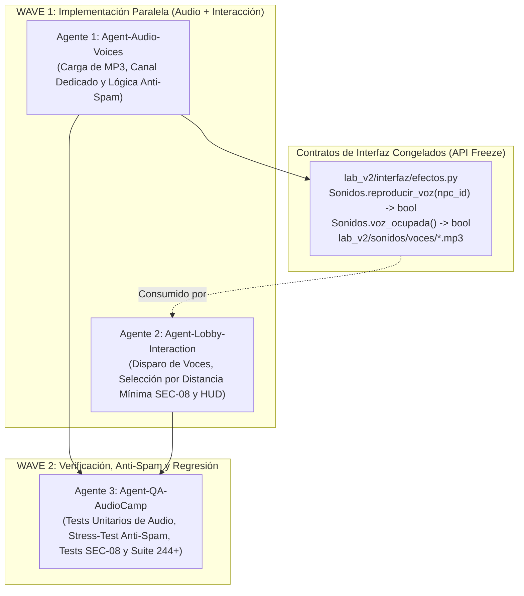

# Plan de Orquestación Multi-Agente: Sistema de Voces de NPCs (Doblaje en Lobby con Anti-Spam) y Corrección de Interacción SEC-08 (Auditoría del Campamento)

**Proyecto:** *Laberinto: El Umbral de Ceniza* (`lab_v2`)  
**Módulos Afectados:** Motor de Audio (`interfaz/efectos.py`), Pantallas e Interfaz del Campamento (`interfaz/pantallas.py`), Recursos de Audio (`lab_v2/sonidos/voces/`), y Banco de Pruebas (`pruebas/test_voces_campamento.py`).  
**Documento de Referencia:** `AUDIT_CAMPAMENTO.md` (Hallazgo **SEC-08** y mitigación complementaria **SEC-11**).

---

## 1. Objetivos Fundamentales del Plan

1. **Integración Acústica de las Voces de los 4 NPCs en el Campamento:**
   - Incorporar los archivos MP3 existentes en el repositorio (`vozmara.mp3`, `voztizon.mp3`, `voznela.mp3`, `vozivo.mp3`).
   - Normalizar su localización en una estructura de recursos limpia (`lab_v2/sonidos/voces/`) manteniendo compatibilidad con la raíz para evitar errores de ruta.
   - Vincular la reproducción de la voz correspondiente al interactuar con cada NPC (**Mara**, **Tizón**, **Nela**, **Ivo**) en el Claro de Ceniza.

2. **Sistema Anti-Spam Estricto (Reproducción Ininterrumpida):**
   - Si el jugador presiona repetidamente o machaca la tecla de interacción (`E`, `Enter`, `Espacio`), **la voz del NPC NO debe reiniciarse a mitad de frase**.
   - La frase en curso debe terminar completamente antes de que una nueva interacción pueda disparar el audio otra vez.
   - El canal de diálogo se monitorea mediante `canal_voz.get_busy()`, ignorando reinicios concurrentes de audio mientras se mantiene el refresco visual del texto y temporizador en pantalla.

3. **Corrección de Defecto Evidente de Jugabilidad de `AUDIT_CAMPAMENTO.md` (SEC-08):**
   - **Problema Detectado en Auditoría:** La interacción en el campamento utilizaba una cascada lineal rígida `if-elif` con radios gigantes y desproporcionados (Hamaca 120px, Lápidas 140px, Hoguera 125px). Como la Hamaca antecedía a las Lápidas en el código, el jugador estando físicamente sobre las lápidas del cementerio recibía el texto de la hamaca (*"La hamaca está vacía..."*), imposibilitando inspeccionar el cementerio.
   - **Solución en Jugabilidad:** Reemplazar la cascada rígida por un algoritmo de **Distancia Euclidiana Mínima** (`min(distancia)`) dentro de un radio normalizado (`RADIO_INTERACCION = 85`). El jugador siempre interactuará con el elemento al que realmente esté más cerca.
   - **Sincronización de HUD (SEC-11):** Sincronizar el cálculo con `_objetivo_cercano()` para que la barra inferior indique contextualmente `"E  ·  EXAMINAR LÁPIDAS"`, `"E  ·  EXAMINAR HAMACA"`, `"E  ·  CONSULTAR MAPA"`, etc.

---

## 2. Topología de Agentes y Matriz de Propiedad Estricta (Zero-Conflict)

Los archivos modificables están estrictamente particionados para garantizar cero solapamiento ni conflictos de merge:

$$\text{Archivos}(\text{Agent-Audio-Voices}) \cap \text{Archivos}(\text{Agent-Lobby-Interaction}) \cap \text{Archivos}(\text{Agent-QA-AudioCamp}) = \emptyset$$



### Tabla de Propiedad Exclusiva de Archivos

| Agente | Identificador | Rol Especializado | Modelo Recomendado | Archivos de Escritura Exclusiva | Archivos de Solo Lectura |
| :--- | :--- | :--- | :--- | :--- | :--- |
| **Agente 1** | `Agent-Audio-Voices` | Ingeniero de Audio y Canales de Sonido. | `Claude Sonnet 5.5 (Medium)` | • `lab_v2/interfaz/efectos.py`<br>• `lab_v2/sonidos/voces/` *(carpeta y copias)* | • `lab_v2/interfaz/pantallas.py`<br>• `lab_v2/interfaz/app.py`<br>• `AUDIT_CAMPAMENTO.md` |
| **Agente 2** | `Agent-Lobby-Interaction` | Desarrollador de Gameplay e Interfaz de Campamento. | `Claude Sonnet 5.5 (Medium)` / `Gemini 4 Argon` | • `lab_v2/interfaz/pantallas.py` | • `lab_v2/interfaz/efectos.py`<br>• `lab_v2/sonidos/voces/*`<br>• `AUDIT_CAMPAMENTO.md` |
| **Agente 3** | `Agent-QA-AudioCamp` | Ingeniero de Pruebas de Integración y Regresión. | `Claude Sonnet 5.5 (Medium)` | • `lab_v2/pruebas/test_voces_campamento.py` *(nuevo)* | • Todos los módulos de `lab_v2/*` |

---

## 3. Contratos de Interfaz Compartidos (API Freeze)

### 3.1. Extensión de la Clase `Sonidos` (`lab_v2/interfaz/efectos.py`)

```python
class Sonidos:
    # Identificadores admitidos: "mara", "tizon", "nela", "ivo"
    VOCES_MAP = {
        "mara": ["lab_v2/sonidos/voces/mara.mp3", "vozmara.mp3"],
        "tizon": ["lab_v2/sonidos/voces/tizon.mp3", "voztizon.mp3"],
        "nela": ["lab_v2/sonidos/voces/nela.mp3", "voznela.mp3"],
        "ivo": ["lab_v2/sonidos/voces/ivo.mp3", "vozivo.mp3"],
    }

    def reproducir_voz(self, nombre_npc: str) -> bool:
        """
        Reproduce el archivo de voz del NPC en un canal dedicado.
        
        PROTECCIÓN ANTI-SPAM:
        - Si el canal de voz actual está reproduciendo (self.canal_voz.get_busy()),
          RETORNA False INMEDIATAMENTE y NO reinicia el sonido a media frase.
        - Si el canal está libre, reproduce el audio y retorna True.
        - En caso de silencio (silenciado=True) o mixer inactivo, retorna False sin arrojar excepciones.
        """
        ...

    def voz_ocupada(self) -> bool:
        """Retorna True si un diálogo de voz está sonando actualmente."""
        ...

    def detener_voz(self) -> None:
        """Fuerza la detención de la voz activa si fuera necesario (ej. cambio de pantalla)."""
        ...
```

### 3.2. Contrato de Interacción y Prioridad en `Campamento` (`lab_v2/interfaz/pantallas.py`)

```python
# Puntos de interés del Claro de Ceniza con radio estandarizado y descripción
PUNTOS_CAMPAMENTO = [
    {"id": "umbral", "nombre": "E  ·  ABRIR EL UMBRAL", "radio": 135},
    {"id": "mara", "nombre": "E  ·  HABLAR CON MARA", "radio": RADIO_INTERACCION, "voz": "mara"},
    {"id": "ivo", "nombre": "E  ·  HABLAR CON IVO", "radio": RADIO_INTERACCION, "voz": "ivo"},
    {"id": "nela", "nombre": "E  ·  HABLAR CON NELA", "radio": RADIO_INTERACCION, "voz": "nela"},
    {"id": "tizon", "nombre": "E  ·  TRUEQUE CON TIZÓN", "radio": RADIO_INTERACCION, "voz": "tizon"},
    {"id": "hamaca", "nombre": "E  ·  EXAMINAR HAMACA", "radio": 75},
    {"id": "mapa", "nombre": "E  ·  CONSULTAR MAPA", "radio": 80},
    {"id": "hoguera", "nombre": "E  ·  DESCANSAR EN LA HOGUERA", "radio": 80},
    {"id": "carro", "nombre": "E  ·  INSPECCIONAR CARRO", "radio": 75},
    {"id": "lapidas", "nombre": "E  ·  EXAMINAR LÁPIDAS", "radio": 85},
]
```

---

## 4. Plan de Ejecución por Oleadas (Waves)

```text
├── WAVE 1 (Paralelo):
│   ├── [T-01] [Agent-Audio-Voices] Gestor de Voces de NPCs y Protección Anti-Spam (efectos.py)
│   └── [T-02] [Agent-Lobby-Interaction] Disparo de Voces y Resolución Bug SEC-08 (pantallas.py)
└── WAVE 2 (Verificación):
    └── [T-03] [Agent-QA-AudioCamp] Banco de Pruebas de Audio, Anti-Spam y Regresión Campamento (test_voces_campamento.py)
```

---

### WAVE 1: Implementación Paralela (Audio + Interacción)

#### `[T-01]` Gestor de Voces de NPCs y Protección Anti-Spam
* **Agente Asignado:** `Agent-Audio-Voices`
* **Modelo Recomendado:** `Claude Sonnet 5.5 (Medium)`
* **Archivos de Escritura Exclusiva:** `lab_v2/interfaz/efectos.py`, `lab_v2/sonidos/voces/`
* **Dependencias:** Ninguna (inicio inmediato).
* **Instrucciones Técnicas:**
  1. Crear el directorio `lab_v2/sonidos/voces/` y copiar allí `vozmara.mp3 -> mara.mp3`, `voztizon.mp3 -> tizon.mp3`, `voznela.mp3 -> nela.mp3`, `vozivo.mp3 -> ivo.mp3`, manteniendo copias de respaldo o tolerando búsqueda en la raíz.
  2. En `lab_v2/interfaz/efectos.py`:
     - Asignar y reservar un canal específico para diálogos vocales (ej. `self.canal_voz = pygame.mixer.Channel(7)` con `set_reserved(1)`).
     - Cargar las pistas de voz en `self.voces = {}` mediante `pygame.mixer.Sound(ruta)` con manejo seguro de excepciones (`pygame.error`, `FileNotFoundError`).
     - Implementar `reproducir_voz(nombre_npc)` con la **regla de anti-spam estricta**:
       ```python
       if self.canal_voz and self.canal_voz.get_busy():
           return False  # El NPC está hablando: NO reiniciar
       ```
     - Implementar `voz_ocupada()` y `detener_voz()`.
  3. Comprobar que en entornos sin audio (`self.activo == False`) el juego continúe funcionando silenciosamente sin lanzar excepciones.

#### `[T-02]` Disparo de Voces y Resolución Bug SEC-08 (Auditoría del Campamento)
* **Agente Asignado:** `Agent-Lobby-Interaction`
* **Modelo Recomendado:** `Claude Sonnet 5.5 (Medium)` / `Gemini 4 Argon`
* **Archivos de Escritura Exclusiva:** `lab_v2/interfaz/pantallas.py`
* **Dependencias:** Inicio en paralelo (respeta el contrato de `Sonidos.reproducir_voz`).
* **Instrucciones Técnicas:**
  1. **Solución del Bug SEC-08 (Enmascaramiento de Interacciones):**
     - En `Campamento._interactuar()`, eliminar la cascada `if-elif` rígida y con radios sobredimensionados.
     - Implementar la selección del objetivo por **distancia euclidiana mínima** calculando la distancia del personaje a cada punto de interés y escogiendo el más cercano dentro de su radio válido (`min(candidatos_en_rango, key=distancia)`).
     - Ajustar las coordenadas y radios para que las Lápidas (`166, 290`) ya no sean absorbidas por la Hamaca (`266, 356`).
  2. **Integración de Voces de NPCs:**
     - Al interactuar con Mara: activar diálogo y llamar `self.app.sonidos.reproducir_voz("mara")`.
     - Al interactuar con Ivo: activar diálogo y llamar `self.app.sonidos.reproducir_voz("ivo")`.
     - Al interactuar con Nela: activar diálogo y llamar `self.app.sonidos.reproducir_voz("nela")`.
     - Al interactuar con Tizón: activar diálogo y llamar `self.app.sonidos.reproducir_voz("tizon")`.
  3. **Sincronización del HUD Contextual (SEC-11):**
     - Actualizar `_objetivo_cercano()` para que incluya todos los puntos interactivos del campamento (Lápidas, Carro, Hamaca, Mapa, Hoguera), mostrando en la barra inferior `"E · EXAMINAR LÁPIDAS"`, etc.

---

### WAVE 2: Verificación, Anti-Spam y Regresión

#### `[T-03]` Banco de Pruebas de Audio, Anti-Spam y Regresión Campamento
* **Agente Asignado:** `Agent-QA-AudioCamp`
* **Modelo Recomendado:** `Claude Sonnet 5.5 (Medium)`
* **Archivos de Escritura Exclusiva:** `lab_v2/pruebas/test_voces_campamento.py`
* **Dependencias:** `[T-01]`, `[T-02]`
* **Instrucciones Técnicas:**
  1. Crear `lab_v2/pruebas/test_voces_campamento.py` con pruebas unitarias y de integración:
     - `test_carga_archivos_voces`: Verificar que los 4 archivos de audio existen y son cargados correctamente por `Sonidos`.
     - `test_antispam_canal_ocupado`: Simular 10 pulsaciones rápidas consecutivas sobre Mara y verificar que `reproducir_voz` solo ejecuta una vez y rechaza los reinicios mientras el canal esté ocupado (`busy`).
     - `test_resolucion_sec08_lapidas_vs_hamaca`: Situar al jugador en `(180, 300)` (junto a las lápidas) y comprobar que la interacción seleccionada son las Lápidas y NO la Hamaca.
     - `test_hud_contextual_objetos`: Verificar que `_objetivo_cercano()` devuelve el texto correcto para cada objeto.
  2. Ejecutar la suite completa del proyecto (`python -m unittest discover -s lab_v2/pruebas`) asegurando que los 244 tests previos más los nuevos pasen con resultado exitoso (0 fallos, 0 errores).

---

## 5. Asignación de Agentes, Modelos y Prompts de Ejecución

### Resumen de Recursos Necesarios
* **Total de Agentes Requeridos:** 3 agentes en 2 oleadas (Wave 1: 2 agentes paralelos; Wave 2: 1 agente de control de calidad).
* **Modelos Aptos:**
  - `Claude Sonnet 5.5 (Medium)` para lógica de canales de audio, anti-spam y suite de tests.
  - `Claude Sonnet 5.5` o `Gemini 4 Argon` para interfaz de campamento y matemáticas de proximidad espacial.

---

### 📋 PROMPT LISTO PARA AGENTE 1 (`Agent-Audio-Voices`)
```text
Rol: Agent-Audio-Voices (Ingeniero de Audio y Canales de Sonido)
Modelo Recomendado: Claude Sonnet 5.5 (Medium)
Archivos de Escritura Exclusiva:
- lab_v2/interfaz/efectos.py
- lab_v2/sonidos/voces/ (crear carpeta y copiar archivos mp3)
Archivos de Solo Lectura:
- lab_v2/interfaz/pantallas.py
- AUDIT_CAMPAMENTO.md

Tu misión es implementar la carga de voces y el sistema de reproducción con protección anti-spam en lab_v2:
1. En la raíz del proyecto existen 4 archivos: vozmara.mp3, voztizon.mp3, voznela.mp3 y vozivo.mp3.
   Crea el directorio lab_v2/sonidos/voces/ y copia allí los archivos renombrándolos a mara.mp3, tizon.mp3, nela.mp3 e ivo.mp3 (mantén compatibilidad para buscar tanto en esa ruta como en la raíz).
2. En lab_v2/interfaz/efectos.py extiende la clase Sonidos:
   - Configura un canal de audio reservado para voces de personajes (self.canal_voz = pygame.mixer.Channel(7) o similar, con pygame.mixer.set_reserved(1)).
   - Carga las voces en un diccionario self.voces con control seguro de excepciones.
   - Implementa reproducir_voz(nombre_npc):
     * REQUISITO CLAVE ANTI-SPAM: Si self.canal_voz.get_busy() es True, RETORNA False y NO REINICIES el sonido a media frase. Deja que el diálogo actual termine de hablar por completo.
     * Si no está ocupado, reproduce la voz y retorna True.
   - Implementa voz_ocupada() -> bool y detener_voz() -> None.
   - Asegura degradación suave: si el mixer no inicializa (modo headless o sin audio), no arrojes errores.
3. No toques archivos fuera de tu titularidad. Al terminar, notifica el freeze de la API.
```

---

### 📋 PROMPT LISTO PARA AGENTE 2 (`Agent-Lobby-Interaction`)
```text
Rol: Agent-Lobby-Interaction (Desarrollador de Gameplay e Interfaz de Campamento)
Modelo Recomendado: Claude Sonnet 5.5 (Medium) / Gemini 4 Argon
Archivos de Escritura Exclusiva:
- lab_v2/interfaz/pantallas.py
Archivos de Solo Lectura:
- lab_v2/interfaz/efectos.py
- AUDIT_CAMPAMENTO.md

Tu misión es integrar la reproducción de voces en el Claro de Ceniza y corregir el bug de jugabilidad SEC-08 de AUDIT_CAMPAMENTO.md:
1. Corrección del Bug SEC-08 (Enmascaramiento de interacción):
   - En la clase Campamento, reemplaza la cascada lineal rígida if-elif de _interactuar() por una selección basada en distancia euclidiana mínima (min(candidatos_en_rango, key=lambda c: c['distancia'])).
   - Corrige las colisiones de radios (especialmente Hamaca vs Lápidas): un jugador junto a las lápidas (166, 290) debe examinar las lápidas y no la hamaca.
   - Normaliza los radios de interacción a valores razonables (85px para NPCs y lápidas, 75-80px para hamaca, carro, mapa y hoguera).
2. Integración de Voces de NPCs:
   - Al interactuar con Mara, Ivo, Nela o Tizón, además de mostrar el texto y mensaje_tiempo, llama a self.app.sonidos.reproducir_voz(nombre_npc).
   - Recuerda que reproducir_voz cuenta con protección anti-spam, por lo que puedes llamarlo en cada interacción de forma segura.
3. Indicadores de HUD Contextual (SEC-11):
   - Actualiza _objetivo_cercano() para que devuelva la etiqueta contextual correspondiente para TODOS los objetos interactivos (Lápidas, Carro, Hamaca, Hoguera, Mapa, además de los NPCs y el Umbral).
4. Respeta tu titularidad de archivos exclusiva (solo lab_v2/interfaz/pantallas.py).
```

---

### 📋 PROMPT LISTO PARA AGENTE 3 (`Agent-QA-AudioCamp`)
```text
Rol: Agent-QA-AudioCamp (Ingeniero de Pruebas de Integración y Regresión)
Modelo Recomendado: Claude Sonnet 5.5 (Medium)
Archivos de Escritura Exclusiva:
- lab_v2/pruebas/test_voces_campamento.py
Archivos de Solo Lectura:
- Todos los módulos de lab_v2/*

Tu misión es verificar formalmente la integración de voces, la protección anti-spam y la corrección SEC-08:
1. Crea lab_v2/pruebas/test_voces_campamento.py:
   - test_carga_voces_existentes: Verifica que las 4 voces (mara, tizon, nela, ivo) son localizadas y cargadas.
   - test_proteccion_antispam_voces: Comprueba con un mock o canal que si canal.get_busy() es True, reproducir_voz rechaza la invocación sin reiniciar la pista.
   - test_correccion_sec08_lapidas_prioridad: Coloca al personaje junto al cementerio y valida que _interactuar() selecciona las lápidas y no la hamaca.
   - test_hud_contextual_completo: Valida que _objetivo_cercano() reconoce lápidas, carro, hoguera, etc.
2. Ejecuta la suite completa de pruebas:
   python -m unittest discover -s lab_v2/pruebas
   Verifica que los 244 tests de regresión previos más los nuevos pasen con 0 errores y 0 fallos.
```
