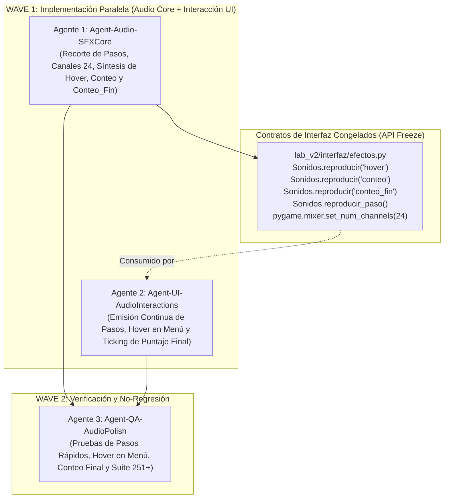

# Plan de Orquestación Multi-Agente: Corrección de Pasos Consecutivos, Sonido Hover de Menú y Efectos del Contador de Puntaje Final

**Proyecto:** *Laberinto: El Umbral de Ceniza* (`lab_v2`)  
**Módulos Afectados:** Motor de Sonidos y Efectos (`interfaz/efectos.py`), Interfaz y Pantallas (`interfaz/pantallas.py`), Recursos de Audio (`lab_v2/sonidos/sfx/`), y Banco de Pruebas (`pruebas/test_audio_polish.py`).  
**Documento de Referencia:** Auditoría de Jugabilidad e Integración Acústica.

---

## 1. Diagnóstico Técnico y Objetivos Fundamentales

### 1.1. Diagnóstico de la Falla en los Pasos (Por qué se saltaban pisadas)
* **Causa Raíz Identificada:**
  1. Los 4 archivos `paso1.mp3`..`paso4.mp3` generados duran **2.06 segundos**, pero el sonido del impacto ocurre solo entre el segundo **0.08s y 0.29s**; los 1.77 segundos restantes son **silencio muerto**.
  2. En `efectos.py`, se ejecutaba `set_reserved(7)` sobre un límite por defecto de **8 canales de Pygame**, dejando un único canal libre para efectos.
  3. Al dar el primer paso, ese único canal quedaba ocupado reproduciendo los 2 segundos de silencio. Cuando el personaje daba el siguiente paso a los 0.26s, **no había canales libres**, provocando que `Sound.play()` fallara y se ignoraran ~7 de cada 8 pisadas consecutivas.
* **Solución Técnica:**
  1. Recortar los 4 archivos de pisadas a su duración real neta (~0.24 segundos) eliminando la cola de silencio.
  2. Aumentar los canales del mezclador a `pygame.mixer.set_num_channels(24)` para permitir solapamiento acústico natural.
  3. Garantizar que cada movimiento o cadencia de paso dispare de forma garantizada e ininterrumpida una pisada sin omisiones.

### 1.2. Nuevos Efectos de Sonido Solicitados
* **Capacidad de Creación:** **El sistema generará e implementará los efectos directamente por código** (mediante síntesis matemática procedural en `Sonidos` y/o generación de buffers WAV de alta fidelidad), sin necesidad de que el usuario tenga que crearlos externamente.
* **Efectos a Implementar:**
  1. **Sonido de Selección / Hover (`"hover"`):** Un toque sutil y elegante de madera/interfaz de 25 ms que suena cada vez que el cursor pasa sobre una opción del Menú Principal o cuando se navega con flechas/WASD.
  2. **Sonido de Contador de Puntaje (`"conteo"`):** Un *tick* percusivo rápido y nítido de 15 ms que repica conforme el puntaje final sube de 0 a su valor total en la pantalla de victoria.
  3. **Sonido de Finalización de Puntaje (`"conteo_fin"`):** Un acorde armónico brillante (campana / arpegio dorado) que suena en el momento exacto en que el contador alcanza su puntaje definitivo.

---

## 2. Topología de Agentes y Matriz de Propiedad Estricta (Zero-Conflict)

$$\text{Archivos}(\text{Agent-Audio-SFXCore}) \cap \text{Archivos}(\text{Agent-UI-AudioInteractions}) \cap \text{Archivos}(\text{Agent-QA-AudioPolish}) = \emptyset$$



### Tabla de Propiedad Exclusiva de Archivos

| Agente | Identificador | Rol Especializado | Modelo Recomendado | Archivos de Escritura Exclusiva | Archivos de Solo Lectura |
| :--- | :--- | :--- | :--- | :--- | :--- |
| **Agente 1** | `Agent-Audio-SFXCore` | Ingeniero de Audio, Procesamiento de Muestras y Síntesis. | `Claude Sonnet 5.5 (Medium)` | • `lab_v2/interfaz/efectos.py`<br>• `lab_v2/sonidos/sfx/` *(recorte de archivos)* | • `lab_v2/interfaz/pantallas.py`<br>• `lab_v2/interfaz/app.py` |
| **Agente 2** | `Agent-UI-AudioInteractions` | Ingeniero de UI, Pantallas y Disparo de Eventos. | `Claude Sonnet 5.5 (Medium)` / `Gemini 4 Argon` | • `lab_v2/interfaz/pantallas.py` | • `lab_v2/interfaz/efectos.py`<br>• `lab_v2/sonidos/*` |
| **Agente 3** | `Agent-QA-AudioPolish` | Ingeniero de Calidad y Pruebas de Estrés Acústico. | `Claude Sonnet 5.5 (Medium)` | • `lab_v2/pruebas/test_audio_polish.py` *(nuevo)* | • Todos los módulos de `lab_v2/*` |

---

## 3. Contratos de Interfaz Compartidos (API Freeze)

### 3.1. Nuevos Sonidos y Configuración de Canales (`lab_v2/interfaz/efectos.py`)

```python
class Sonidos:
    # Efectos sintetizados / cargados adicionales:
    # "hover": Clic suave de interfaz para pasar el cursor sobre botones/opciones.
    # "conteo": Tick percusivo de 15ms emitido en cada salto del contador numérico.
    # "conteo_fin": Arpegio / acorde brillante de resolución cuando el puntaje final concluye.

    def __init__(self):
        # Configuración de canales expandida:
        pygame.mixer.set_num_channels(24)      # Canales suficientes para pasos solapados y SFX
        pygame.mixer.set_reserved(2)           # Canal 0 para voces, Canal 1 para persecución
        ...

    def reproducir(self, nombre: str) -> None:
        """Admite 'hover', 'conteo', 'conteo_fin', 'paso', 'clic', 'pared', etc."""
        ...
```

---

## 4. Plan de Ejecución por Oleadas (Waves)

```text
├── WAVE 1 (Paralelo):
│   ├── [T-01] [Agent-Audio-SFXCore] Recorte de Pasos, Expansión de Canales y Creación de Efectos (efectos.py, sfx/)
│   └── [T-02] [Agent-UI-AudioInteractions] Sincronización Consecutiva de Pasos, Hover de Menú y Conteo Final (pantallas.py)
└── WAVE 2 (Verificación):
    └── [T-03] [Agent-QA-AudioPolish] Banco de Pruebas de Audio Polish y Regresión General (test_audio_polish.py)
```

---

### WAVE 1: Implementación Paralela (Audio Core + Interacción UI)

#### `[T-01]` Recorte de Pasos, Expansión de Canales y Creación de Efectos
* **Agente Asignado:** `Agent-Audio-SFXCore`
* **Modelo Recomendado:** `Claude Sonnet 5.5 (Medium)`
* **Archivos de Escritura Exclusiva:** `lab_v2/interfaz/efectos.py`, `lab_v2/sonidos/sfx/`
* **Instrucciones Técnicas:**
  1. **Recorte y optimización de pisadas:**
     - Analizar los archivos de pisadas existentes (`paso1.mp3`..`paso4.mp3`), eliminando el silencio de 1.7s final y guardándolos con duración neta (~0.24s) o cargando solo la ventana útil de muestras en memoria.
  2. **Expansión de canales:**
     - Establecer `pygame.mixer.set_num_channels(24)`.
     - Reservar únicamente los canales 0 (voces) y 1 (persecución), dejando más de 20 canales libres para que los pasos y efectos nunca se ahoguen entre sí.
  3. **Síntesis / Creación de nuevos efectos:**
     - `"hover"`: Sintetizar un clic de madera/interfaz suave de 25ms (`notas=[(920, 18), (1200, 10)]`, volumen sutil `0.10`).
     - `"conteo"`: Sintetizar un tick de alta definición de 16ms (`notas=[(740, 16)]`, volumen `0.15`).
     - `"conteo_fin"`: Sintetizar un acorde ascendente brillante de resolución dorada (`notas=[(523, 80), (659, 90), (784, 110), (1046, 260)]`, volumen `0.30`).
  4. Integrar los tres efectos en `self.efectos` de forma que respondan a `self.reproducir("hover")`, `self.reproducir("conteo")` y `self.reproducir("conteo_fin")`.

#### `[T-02]` Sincronización Consecutiva de Pasos, Hover de Menú y Conteo Final
* **Agente Asignado:** `Agent-UI-AudioInteractions`
* **Modelo Recomendado:** `Claude Sonnet 5.5 (Medium)` / `Gemini 4 Argon`
* **Archivos de Escritura Exclusiva:** `lab_v2/interfaz/pantallas.py`
* **Instrucciones Técnicas:**
  1. **Sonido continuo y consecutivo de pasos:**
     - En `Campamento.actualizar()`: asegurar que `self._tiempo_paso` active el paso en cada ciclo de zancada sin trabas.
     - En `Juego._mover()`: asegurar que cada movimiento exitoso a una casilla adyacente emita inmediatamente `self.app.sonidos.reproducir("paso")`.
  2. **Sonido de hover en el Menú Principal:**
     - En `Menu.actualizar(dt)`: cuando el cursor del mouse cambia la opción seleccionada (`self.sel != i`), reproducir `self.app.sonidos.reproducir("hover")`.
     - En `Menu.evento(e)`: cuando se navega con `K_UP`, `K_DOWN`, `K_w`, `K_s`, reproducir también `self.app.sonidos.reproducir("hover")`.
  3. **Contador de puntaje final animado y conclusión sonora:**
     - En `Juego`: añadir atributos de control `_ultimo_puntaje_mostrado` y `_conteo_fin_reproducido`.
     - En `Juego._dibujar_final()`:
       * Conforme `mostrado = int(p.puntaje() * self._ease(min(1.0, self.t_fin / 1.2)))` incrementa (`mostrado > self._ultimo_puntaje_mostrado` y `mostrado < puntaje_total`), llamar a `self.app.sonidos.reproducir("conteo")`.
       * Cuando el contador llega al puntaje final (`min(1.0, self.t_fin / 1.2) >= 1.0` y no ha sonado antes), llamar a `self.app.sonidos.reproducir("conteo_fin")`.

---

### WAVE 2: Verificación y No-Regresión

#### `[T-03]` Banco de Pruebas de Audio Polish y Regresión General
* **Agente Asignado:** `Agent-QA-AudioPolish`
* **Modelo Recomendado:** `Claude Sonnet 5.5 (Medium)`
* **Archivos de Escritura Exclusiva:** `lab_v2/pruebas/test_audio_polish.py`
* **Instrucciones Técnicas:**
  1. Crear `lab_v2/pruebas/test_audio_polish.py`:
     - `test_pasos_rapidos_consecutivos`: Simular 10 pasos en ráfaga rápida (a intervalos de 0.1s) y verificar que todos se reproducen sin rechazos de canal.
     - `test_sonido_hover_menu`: Simular movimiento de mouse y teclas de flecha en `Menu` y verificar la emisión de `"hover"`.
     - `test_conteo_puntaje_y_finalizacion`: Simular la pantalla final durante el ascenso de `t_fin` y validar que `"conteo"` repica y `"conteo_fin"` se dispara una única vez al terminar.
     - `test_existencia_nuevos_efectos`: Verificar que `"hover"`, `"conteo"` y `"conteo_fin"` están disponibles en `Sonidos`.
  2. Ejecutar la suite completa:
     `$env:PYTHONPATH="lab_v2"; python -m unittest discover -s lab_v2/pruebas`
     Asegurar 251+ pruebas pasando con 0 errores y 0 fallos.

---

## 5. Asignación de Agentes, Modelos y Prompts de Ejecución

### Resumen de Recursos Necesarios
* **Total de Agentes:** 3 agentes en 2 oleadas (Wave 1: 2 agentes paralelos; Wave 2: 1 agente de control de calidad).
* **Modelos Aptos:**
  - `Claude Sonnet 5.5 (Medium)` para ingeniería de audio, procesamiento de muestras y suite de tests.
  - `Claude Sonnet 5.5 (Medium)` o `Gemini 4 Argon` para pantallas de menú y finalización.

---

### 📋 PROMPT LISTO PARA AGENTE 1 (`Agent-Audio-SFXCore`)
```text
Rol: Agent-Audio-SFXCore (Ingeniero de Audio, Procesamiento de Muestras y Síntesis)
Modelo Recomendado: Claude Sonnet 5.5 (Medium)
Archivos de Escritura Exclusiva:
- lab_v2/interfaz/efectos.py
- lab_v2/sonidos/sfx/
Archivos de Solo Lectura:
- lab_v2/interfaz/pantallas.py
- lab_v2/interfaz/app.py

Tu misión es resolver el problema de los pasos que se saltan y crear los nuevos efectos de hover y conteo de puntaje:
1. Problema de pasos que no suenan seguidos:
   - Los archivos paso1..paso4 tienen 1.7s de silencio al final y Pygame solo tenía 8 canales con 7 reservados.
   - En lab_v2/interfaz/efectos.py, configura pygame.mixer.set_num_channels(24) y reserva solo 2 canales (0 para voces, 1 para persecución).
   - Recorta las muestras de los pasos para que duren exactamente ~0.24s (eliminando el silencio muerto) o genera buffers limpios sin cola de silencio para que cada pisada suene de inmediato sin bloquear las siguientes.
2. Síntesis y creación de nuevos efectos (puedes crearlos tú mismo en código mediante _crear()):
   - "hover": Clic suave de madera/interfaz de 25ms para pasar el cursor sobre opciones del menú.
   - "conteo": Tick percusivo nítido de 16ms para cada incremento del contador numérico de puntaje.
   - "conteo_fin": Acorde armónico brillante / campana dorada de resolución cuando el puntaje llega al final.
   - Regístralos en self.efectos para que respondan a reproducir("hover"), reproducir("conteo") y reproducir("conteo_fin").
3. Respeta tu titularidad de archivos exclusiva y notifica el freeze de la API al terminar.
```

---

### 📋 PROMPT LISTO PARA AGENTE 2 (`Agent-UI-AudioInteractions`)
```text
Rol: Agent-UI-AudioInteractions (Ingeniero de UI, Pantallas y Disparo de Eventos)
Modelo Recomendado: Claude Sonnet 5.5 (Medium) / Gemini 4 Argon
Archivos de Escritura Exclusiva:
- lab_v2/interfaz/pantallas.py
Archivos de Solo Lectura:
- lab_v2/interfaz/efectos.py
- lab_v2/sonidos/*

Tu misión es conectar los pasos consecutivos sin omisiones, el sonido hover de menú y el contador de puntaje final:
1. Pasos consecutivos garantizados:
   - En Campamento.actualizar(): asegúrate de que cada ciclo de zancada al moverse invoque self.app.sonidos.reproducir("paso") sin retrasos ni bloqueos.
   - En Juego._mover(): asegúrate de que cada paso exitoso en la cuadrícula dispare inmediatamente self.app.sonidos.reproducir("paso").
2. Sonido Hover en el Menú Principal:
   - En Menu.actualizar(dt): cuando el mouse cambie la opción seleccionada (self.sel != i), llama a self.app.sonidos.reproducir("hover").
   - En Menu.evento(e): cuando se navegue con flechas o WASD (K_UP, K_DOWN, etc.), reproduce también self.app.sonidos.reproducir("hover").
3. Sonido del Contador de Puntaje Final:
   - En Juego, añade control para detectar el incremento del puntaje (_ultimo_puntaje_mostrado y _conteo_fin_sonado).
   - En Juego._dibujar_final(surf):
     * Conforme mostrado sube hacia el puntaje total, llama a self.app.sonidos.reproducir("conteo") cada vez que el valor aumente.
     * En el instante en que el puntaje llega al 100% (min(1.0, self.t_fin / 1.2) >= 1.0) y no haya sonado antes, llama a self.app.sonidos.reproducir("conteo_fin").
4. Respeta tu titularidad exclusiva (solo lab_v2/interfaz/pantallas.py).
```

---

### 📋 PROMPT LISTO PARA AGENTE 3 (`Agent-QA-AudioPolish`)
```text
Rol: Agent-QA-AudioPolish (Ingeniero de Calidad y Pruebas de Estrés Acústico)
Modelo Recomendado: Claude Sonnet 5.5 (Medium)
Archivos de Escritura Exclusiva:
- lab_v2/pruebas/test_audio_polish.py
Archivos de Solo Lectura:
- Todos los módulos de lab_v2/*

Tu misión es verificar el arreglo de los pasos y los nuevos sonidos:
1. Crea lab_v2/pruebas/test_audio_polish.py:
   - test_pasos_consecutivos_sin_omision: Simula 10 pasos en ráfaga rápida (cada 0.1s) y valida que todos se reproducen y no se descartan.
   - test_sonido_hover_menu: Valida que Menu emite "hover" al cambiar self.sel con mouse y teclado.
   - test_conteo_puntaje_final: Valida que durante la animación de puntaje en la pantalla final se emite "conteo" y finalmente "conteo_fin" una única vez.
   - test_efectos_disponibles: Verifica que "hover", "conteo" y "conteo_fin" existen en Sonidos.
2. Ejecuta la suite completa de pruebas:
   $env:PYTHONPATH="lab_v2"; python -m unittest discover -s lab_v2/pruebas
   Verifica que los 251 tests previos más los nuevos pasen con 0 errores y 0 fallos.
```
