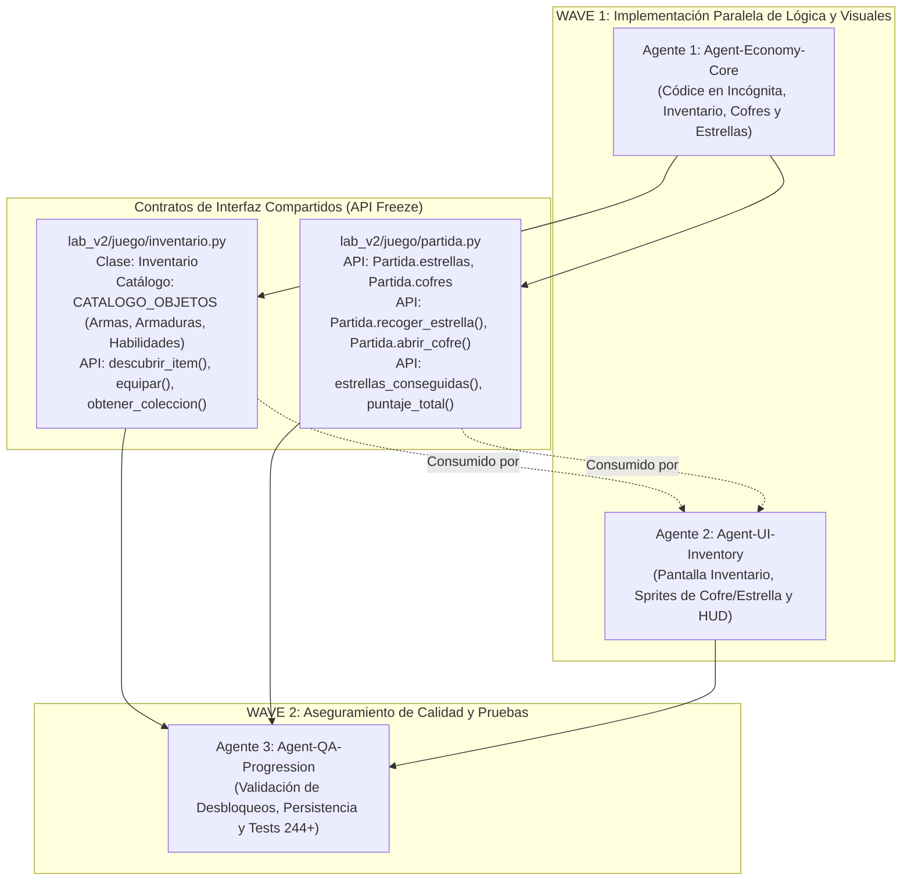

# Plan de Orquestación Multi-Agente: Sistema de Coleccionables (Estrellas y Cofres), Códice Oculto (Objetos en Incógnita) e Inventario de Equipamiento

**Proyecto:** *Laberinto: El Umbral de Ceniza* (`lab_v2`)  
**Módulos Afectados:** Motor de Progresión (`juego/inventario.py`), Ciclo de Partida y Generación (`juego/partida.py`), Renderizado Gráfico (`interfaz/render.py`), Pantallas e Interfaz (`interfaz/pantallas.py`) y Banco de Pruebas (`pruebas/test_inventario.py`, `pruebas/test_partida.py`).  
**Objetivo Fundamental:**
1. **Calificación Estelar y Coleccionables (Riesgo vs. Recompensa):** Distribuir proceduralmente **3 Estrellas** y **Cofres del Tesoro** en ramales secundarios ciegos del laberinto (fuera de la ruta óptima segura), motivando al jugador a adentrarse en territorio de patrulla enemiga. Calificar cada nivel de **★☆☆ (1 estrella)** a **★★★ (3 estrellas)** según su desempeño y recolección.
2. **Códice de Colección en Incógnita (Objetos Desconocidos):** Implementar un catálogo completo de **Armas**, **Armaduras** y **Habilidades Pasivas**. Al abrir el inventario, los objetos no encontrados se muestran como **siluetas en penumbra con candado y título `???`** ("Objeto no descubierto: busca en los cofres del laberinto"). Esto fomenta el deseo de explorar y rejugar para completar el 100% de la colección.
3. **Botín de Cofres y Desbloqueo Dinámico:** Al pisar y abrir un cofre en una partida, se revela y desbloquea un nuevo ítem del códice, emitiendo un anuncio destacado en el HUD, confeti/brasas doradas y guardándolo de forma permanente en `checkpoint.json`.
4. **Pantalla de Inventario y Equipamiento:** Pantalla interactiva (accesible con tecla `I` o `Tab` tanto en el Campamento como durante la partida) que permite al jugador inspeccionar su colección, ver su progreso (ej. *4/12 Objetos Descubiertos*) y equipar 1 Arma, 1 Armadura y 1 Habilidad activa que alteran sus estadísticas de juego.

---

## 1. Topología de Agentes y Matriz de Propiedad Estricta (Zero-Conflict)

Cada agente posee la titularidad exclusiva de un conjunto disjunto de archivos, eliminando colisiones de código y permitiendo desarrollo en paralelo:

$$\text{Archivos}(\text{Agent-Economy-Core}) \cap \text{Archivos}(\text{Agent-UI-Inventory}) \cap \text{Archivos}(\text{Agent-QA-Progression}) = \emptyset$$



### Tabla de Propiedad Exclusiva de Archivos

| Agente | Identificador | Rol Especializado | Modelo Sugerido | Archivos de Escritura Exclusiva | Archivos de Solo Lectura |
| :--- | :--- | :--- | :--- | :--- | :--- |
| **Agente 1** | `Agent-Economy-Core` | Arquitecto de Progresión, Lógica de Ítems, Estructuras y Partida. | `Claude Sonnet 5.5` | • `lab_v2/juego/inventario.py` *(nuevo)*<br>• `lab_v2/juego/partida.py` | • `lab_v2/interfaz/*`<br>• `lab_v2/pruebas/*`<br>• `lab_v2/estructuras/*` |
| **Agente 2** | `Agent-UI-Inventory` | Ingeniero de Interfaz, Arte de HUD, Renderizado de Cofres/Estrellas. | `Gemini 4 Argon` | • `lab_v2/interfaz/pantallas.py`<br>• `lab_v2/interfaz/render.py` | • `lab_v2/juego/*`<br>• `lab_v2/pruebas/*`<br>• `lab_v2/datos/*` |
| **Agente 3** | `Agent-QA-Progression` | Especialista en Pruebas de Persistencia, Mocking y No Regresión. | `Claude Sonnet 5.5` / `Gemini 4 Hydrogen` | • `lab_v2/pruebas/test_inventario.py` *(nuevo)*<br>• `lab_v2/pruebas/test_partida.py` | • Todos los módulos de `lab_v2/juego/*` e `lab_v2/interfaz/*` |

---

## 2. Contratos de Interfaz Compartidos (API Freeze)

### 2.1. Catálogo e Inventario (`lab_v2/juego/inventario.py`)

```python
CATEGORIA_ARMA = "arma"
CATEGORIA_ARMADURA = "armadura"
CATEGORIA_HABILIDAD = "habilidad"

CATALOGO_OBJETOS = {
    # ---------------- ARMAS ----------------
    "espada_ceniza": {
        "id": "espada_ceniza", "categoria": CATEGORIA_ARMA, "nombre": "Espada de Ceniza",
        "descripcion": "Hoja imbuida con fuego verde. Corta esqueletos frontales.",
        "rareza": "Común", "desbloqueado_inicio": True, "icono": "espada"
    },
    "daga_sombras": {
        "id": "daga_sombras", "categoria": CATEGORIA_ARMA, "nombre": "Daga de Sombras",
        "descripcion": "Ataca en ráfaga circular a enemigos adyacentes a corta distancia.",
        "rareza": "Rara", "desbloqueado_inicio": False, "icono": "daga"
    },
    "baston_centella": {
        "id": "baston_centella", "categoria": CATEGORIA_ARMA, "nombre": "Bastón de Centella",
        "descripcion": "Dispara un destello en línea recta que aturde a un enemigo 3s.",
        "rareza": "Épica", "desbloqueado_inicio": False, "icono": "baston"
    },
    # ---------------- ARMADURAS ----------------
    "manto_viajero": {
        "id": "manto_viajero", "categoria": CATEGORIA_ARMADURA, "nombre": "Manto del Viajero",
        "descripcion": "Prenda ligera de tela reforzada. Atuendo inicial.",
        "rareza": "Común", "desbloqueado_inicio": True, "icono": "tunica"
    },
    "coraza_guardian": {
        "id": "coraza_guardian", "categoria": CATEGORIA_ARMADURA, "nombre": "Coraza del Guardián",
        "descripcion": "Armadura de placas rúnicas. Otorga +5 movimientos máximos por nivel.",
        "rareza": "Rara", "desbloqueado_inicio": False, "icono": "coraza"
    },
    "manto_bruma": {
        "id": "manto_bruma", "categoria": CATEGORIA_ARMADURA, "nombre": "Manto de Bruma",
        "descripcion": "Camuflaje espectral. Reduce en 2 casillas el radio de visión de los enemigos.",
        "rareza": "Épica", "desbloqueado_inicio": False, "icono": "manto"
    },
    # ---------------- HABILIDADES PASIVAS ----------------
    "paso_ligero": {
        "id": "paso_ligero", "categoria": CATEGORIA_HABILIDAD, "nombre": "Paso Ligero",
        "descripcion": "Desplazamiento ágil en el campamento y mayor fluidez al deslizar muros.",
        "rareza": "Común", "desbloqueado_inicio": True, "icono": "bota"
    },
    "ojo_zahori": {
        "id": "ojo_zahori", "categoria": CATEGORIA_HABILIDAD, "nombre": "Ojo del Zahorí",
        "descripcion": "El resplandor de la linterna revela la dirección del cofre más cercano.",
        "rareza": "Rara", "desbloqueado_inicio": False, "icono": "ojo"
    },
    "escudo_eco": {
        "id": "escudo_eco", "categoria": CATEGORIA_HABILIDAD, "nombre": "Velo contra el Eco",
        "descripcion": "Retrasa la persecución de tu sombra (+2 pasos de gracia de la Cola).",
        "rareza": "Épica", "desbloqueado_inicio": False, "icono": "escudo"
    },
}

class Inventario:
    def __init__(self, datos_guardados=None):
        """
        Gestiona la colección de objetos descubiertos y el equipamiento activo.
        Si datos_guardados es None, desbloquea solo los iniciales.
        """
        self.desbloqueados = set()
        self.arma_equipada = "espada_ceniza"
        self.armadura_equipada = "manto_viajero"
        self.habilidad_equipada = "paso_ligero"
        self.oro = 0
        self.estrellas_totales = 0
        ...

    def obtener_coleccion(self) -> list[dict]:
        """
        Retorna la lista de todos los objetos del catálogo.
        Si el ítem NO ha sido descubierto:
            nombre = "???"
            descripcion = "Objeto desconocido. Explora los ramales del laberinto y abre cofres para revelarlo."
            icono = "incognita"
            descubierto = False
        Si HA SIDO descubierto:
            descubierto = True (muestra nombre real, descripción y atributos).
        """
        ...

    def descubrir_item(self, id_item: str) -> bool:
        """Desbloquea un ítem en el códice. Retorna True si era nuevo."""
        ...

    def equipar(self, id_item: str) -> bool:
        """Equipa un ítem descubierto en su ranura correspondiente."""
        ...

    def to_dict(self) -> dict: ...
    @classmethod
    def from_dict(cls, datos: dict) -> "Inventario": ...
```

### 2.2. Generación y Recolección en Partida (`lab_v2/juego/partida.py`)

```python
class Partida:
    # Atributos añadidos en __init__:
    # self.estrellas = [(f, c), ...]  # 3 casillas de estrellas en ramales
    # self.estrellas_recogidas = 0
    # self.cofres = [{"casilla": (f, c), "abierto": False, "contenido": id_item_o_oro}]
    # self.cofres_abiertos = 0

    def recoger_estrella(self) -> bool:
        """Si el jugador está sobre una estrella no recogida, la toma (+150 pts)."""
        ...

    def abrir_cofre(self) -> dict | None:
        """Si el jugador está sobre un cofre cerrado, lo abre y entrega el botín."""
        ...

    def estrellas_conseguidas(self) -> int:
        """Retorna cuántas estrellas (1, 2 o 3) se han ganado al terminar."""
        ...
```

---

## 3. Plan de Ejecución por Oleadas (Waves)

---

### WAVE 1: Implementación Paralela de Progresión y Gráficos

```text
├── [T-01] [Agent-Economy-Core] Módulo de Inventario, Códice de Incógnitas y Persistencia (inventario.py)
├── [T-02] [Agent-Economy-Core] Generación de 3 Estrellas y Cofres con Botín en Partida (partida.py)
├── [T-03] [Agent-UI-Inventory] Renderizado estético de Estrellas flotantes y Cofres (render.py)
└── [T-04] [Agent-UI-Inventory] Pantalla de Inventario / Códice Oculto y HUD de Estrellas (pantallas.py)
```

#### `[T-01]` Módulo de Inventario, Códice de Incógnitas y Persistencia
* **Agente Asignado:** `Agent-Economy-Core`
* **Modelo Recomendado:** `Claude Sonnet 5.5 (Medium)`
* **Archivos Objetivo:** `lab_v2/juego/inventario.py`
* **Dependencias:** Inicio inmediato.
* **Instrucciones Técnicas:**
  1. Crear `lab_v2/juego/inventario.py` implementando el catálogo estructurado `CATALOGO_OBJETOS` con las 3 categorías (Armas, Armaduras, Habilidades).
  2. Implementar la clase `Inventario`:
     - Método `obtener_coleccion()` que enmascare como `"???"` con icono `"incognita"` cualquier objeto no registrado en `self.desbloqueados`.
     - Métodos `descubrir_item(id_item)` y `equipar(id_item)`.
     - Serialización limpia `to_dict()` y `from_dict()` compatible con JSON.
     - Métodos auxiliares para sortear un ítem no descubierto al abrir cofres: si todos fueron descubiertos, entrega una bolsa de oro (50 a 100 de oro).
* **Criterio de Verificación:**
  - `Inventario()` nuevo devuelve los 3 ítems iniciales descubiertos y el resto en incógnita (`descubierto=False`, `nombre="???"`). Al llamar `descubrir_item("daga_sombras")`, este pasa a ser visible y equipable.

---

#### `[T-02]` Generación de 3 Estrellas y Cofres con Botín en Partida
* **Agente Asignado:** `Agent-Economy-Core`
* **Modelo Recomendado:** `Claude Sonnet 5.5 (Medium)`
* **Archivos Objetivo:** `lab_v2/juego/partida.py`
* **Dependencias:** `[T-01]`
* **Instrucciones Técnicas:**
  1. En `Partida.__init__`:
     - Llamar a `self._crear_estrellas(3)`: buscar 3 casillas transitables en ramales secundarios que no toquen la ruta directa a la salida (`solucion`).
     - Llamar a `self._crear_cofres(1 if nivel["filas"] < 12 else 2)`: situar cofres en esquinas de ramales lejanos con botín del códice.
  2. Implementar `recoger_estrella()` y `abrir_cofre()` en el ciclo de movimiento:
     - Si `self.jugador.posicion` coincide con una estrella, se retira de la lista y suma a `self.estrellas_recogidas`.
     - Si coincide con un cofre cerrado, cambia su estado a `abierto = True` y entrega su contenido.
  3. Actualizar `Partida.puntaje()`:
     $$\text{puntaje} = \text{base} + (\text{movimientos\_restantes} \times 10) + (\text{estrellas\_recogidas} \times 150) + \text{oro\_partida}$$
  4. Implementar `estrellas_conseguidas()`:
     - 1 Estrella: Ganar la partida llegando a la meta.
     - 2 Estrellas: Ganar habiendo recogido al menos 2 estrellas o 1 cofre.
     - 3 Estrellas: Ganar habiendo recogido las 3 estrellas del nivel.
* **Criterio de Verificación:**
  - Toda partida creada genera exactamente 3 estrellas y al menos 1 cofre en ramales válidos sin bloquear el camino principal.

---

#### `[T-03]` Renderizado Estético de Estrellas Flotantes y Cofres
* **Agente Asignado:** `Agent-UI-Inventory`
* **Modelo Recomendado:** `Gemini 4 Argon (Medium)`
* **Archivos Objetivo:** `lab_v2/interfaz/render.py`
* **Dependencias:** Inicio inmediato (contratos de firmas visuales).
* **Instrucciones Técnicas:**
  1. Implementar `dibujar_estrella(surf, cx, cy, cell, t)`:
     - Estrella dorada/gema centelleante con levitación senoidal `math.sin(t * 3.5) * 3` px.
     - Partículas sutiles de polvo dorado a su alrededor.
  2. Implementar `dibujar_cofre(surf, cx, cy, cell, t, abierto=False)`:
     - Cofre de madera noble con herrajes de bronce.
     - Si `abierto=False`: cofre cerrado con brillo ámbar tenue.
     - Si `abierto=True`: tapa levantada mostrando resplandor interior.
  3. Implementar `dibujar_icono_item(surf, rect, tipo_icono, descubierto=True)`:
     - Si `descubierto=False`: dibuja un candado o silueta oscura con un signo `?` centrado en gris/bronce.
     - Si `descubierto=True`: dibuja el icono distintivo (espada, daga, bastón, túnica, coraza, bota, ojo, escudo).
* **Criterio de Verificación:**
  - El módulo compila sin errores y renderiza correctamente estrellas levitantes y cofres en ambas fases (cerrado/abierto).

---

#### `[T-04]` Pantalla de Inventario / Códice Oculto y HUD de Estrellas
* **Agente Asignado:** `Agent-UI-Inventory`
* **Modelo Recomendado:** `Gemini 4 Argon (Medium)`
* **Archivos Objetivo:** `lab_v2/interfaz/pantallas.py`
* **Dependencias:** `[T-01]`, `[T-02]`, `[T-03]`
* **Instrucciones Técnicas:**
  1. En `Juego`:
     - Dibujar las estrellas y cofres en el tablero llamando a las funciones de `render.py`.
     - Al recoger una estrella o abrir un cofre: reproducir sonido (`guardar`), emitir partículas y mostrar alerta en pantalla (*"¡Has descubierto Daga de Sombras!"*).
     - Añadir contador visual de 3 estrellas en el HUD superior: `★ ★ ☆`.
     - Al ganar, la pantalla final muestra las 3 estrellas grandes animándose con fanfarria.
  2. Crear clase `PantallaInventario(Pantalla)`:
     - Accesible pulsando la tecla `I` o `Tab` desde `Juego` o `Campamento`.
     - **Sección Izquierda:** Visualización del Viajero con sus 3 ranuras equipadas (Arma, Armadura, Pasiva).
     - **Sección Central (El Códice):** Cuadrícula dividida por pestañas o bloques (Armas, Armaduras, Habilidades). Los ítems bloqueados lucen oscuros con `???` y los descubiertos muestran sus colores de rareza.
     - **Sección Derecha (Ficha de Objeto):** Al hacer clic en un objeto descubierto, muestra su nombre, descripción de historia (*lore*), bonificación y botón `"Equipar"`. Si es incógnita, muestra: *"Aún no has encontrado este artefacto. Explora los cofres del laberinto para descubrirlo."*
     - Botón de volver o reanudar partida.
* **Criterio de Verificación:**
  - Pulsar `I` en cualquier momento abre limpiamente el inventario interactivo; se pueden equipar ítems descubiertos y los no descubiertos permanecen en secreto como `???`.

---

### WAVE 2: Aseguramiento de Calidad y Suite de Pruebas

```text
├── [T-05] [Agent-QA-Progression] Suite Unitaria de Inventario y Códice Oculto (test_inventario.py)
├── [T-06] [Agent-QA-Progression] Pruebas de Estrellas, Cofres y Calificación 1-3 en Partida (test_partida.py)
└── [T-07] [Agent-QA-Progression] Verificación Global de Calidad (Pase 100% de la Suite 250+ tests)
```

#### `[T-05]` Suite Unitaria de Inventario y Códice Oculto
* **Agente Asignado:** `Agent-QA-Progression`
* **Modelo Recomendado:** `Claude Sonnet 5.5 (Medium)` o `Gemini 4 Hydrogen (Medium)`
* **Archivos Objetivo:** `lab_v2/pruebas/test_inventario.py` *(nuevo archivo)*
* **Dependencias:** `[T-01]` finalizado.
* **Instrucciones Técnicas:**
  1. `test_inicializacion_descubiertos()`: Comprobar que solo los ítems marcados por defecto están descubiertos y el resto permanece en incógnita.
  2. `test_mascara_incognita()`: Comprobar que para ítems no descubiertos, `obtener_coleccion()` oculta el nombre real con `"???"` y no filtra descripciones ni atributos.
  3. `test_descubrir_y_equipar()`: Descubrir un ítem, verificar que `descubierto == True`, equiparlo y verificar que `arma_equipada` / `armadura_equipada` se actualiza.
  4. `test_no_se_puede_equipar_incognita()`: Intentar equipar un ítem no descubierto; debe retornar `False`.
  5. `test_serializacion_json()`: Serializar con `to_dict()`, reconstruir con `from_dict()` y comprobar igualdad idéntica de estados.
* **Criterio de Verificación:**
  - `python -m unittest lab_v2/pruebas/test_inventario.py` ejecuta y aprueba todos los tests.

---

#### `[T-06]` Pruebas de Estrellas, Cofres y Calificación 1-3 en Partida
* **Agente Asignado:** `Agent-QA-Progression`
* **Modelo Recomendado:** `Claude Sonnet 5.5 (Medium)` o `Gemini 4 Hydrogen (Medium)`
* **Archivos Objetivo:** `lab_v2/pruebas/test_partida.py`
* **Dependencias:** `[T-02]` finalizado.
* **Instrucciones Técnicas:**
  1. `test_generacion_3_estrellas()`: Comprobar que en cualquier partida válida se generan exactamente 3 estrellas en casillas transitables.
  2. `test_estrellas_no_bloquean_salida()`: Las estrellas no deben obstaculizar la ruta directa.
  3. `test_recoleccion_estrella_suma_puntaje()`: Colocar al jugador sobre una estrella; invocar recolección y verificar que `estrellas_recogidas == 1` y aumenta el puntaje.
  4. `test_abrir_cofre_entrega_botin()`: Colocar al jugador sobre un cofre cerrado; verificar que al abrirlo entrega un ítem o recompensa válida y no puede volver a abrirse.
  5. `test_escala_estrellas_1_2_3()`: Validar que llegar a la salida sin estrellas otorga 1 estrella, con 2 otorga 2 estrellas, y con 3 otorga la calificación perfecta de 3 estrellas.
* **Criterio de Verificación:**
  - `python -m unittest lab_v2/pruebas/test_partida.py` aprueba al 100% conservando todos los casos previos.

---

#### `[T-07]` Verificación Global de Calidad (Pase 100% de la Suite 250+ Tests)
* **Agente Asignado:** `Agent-QA-Progression`
* **Modelo Recomendado:** `Claude Sonnet 5.5 (Medium)`
* **Archivos Objetivo:** Solo lectura / Validación.
* **Dependencias:** `[T-01]` hasta `[T-06]` completados.
* **Instrucciones Técnicas:**
  1. Ejecutar `$env:PYTHONPATH="lab_v2"; python -m unittest discover -s lab_v2/pruebas`.
  2. Comprobar que los 244 tests previos siguen en verde más los nuevos tests de inventario y estrellas.
* **Criterio de Verificación:**
  - Consola final: `Ran 250+ tests ... OK`.

---

## 4. Matriz de Asignación de Modelos

| Agente | Nombre de Rol | Modelo Asignado | Justificación Técnica de Idoneidad |
| :--- | :--- | :--- | :--- |
| **Agente 1** | `Agent-Economy-Core` | **Claude Sonnet 5.5 (Medium)** | Precisión absoluta en modelado de datos de inventario, colecciones ocultas, serialización JSON limpia y colocación procedural en grafos de laberinto. |
| **Agente 2** | `Agent-UI-Inventory` | **Gemini 4 Argon (Medium)** | Especialista en diseño visual de interfaces de usuario (Pixel Art UI), maquetación de cuadrículas interactivas, renderizado senoidal de sprites y animaciones HUD. |
| **Agente 3** | `Agent-QA-Progression` | **Claude Sonnet 5.5 (Medium)** / **Gemini 4 Hydrogen** | Rigor exhaustivo en pruebas de enmascaramiento de incógnitas (`???`), validación de contratos entre módulos y garantía estricta de no-regresión. |
| **Supervisor** | `Orchestrator` | **Orchestrator (Argon)** | Monitorización de dependencias entre oleadas, revisión de contratos de API congelados y resolución de discrepancias. |
