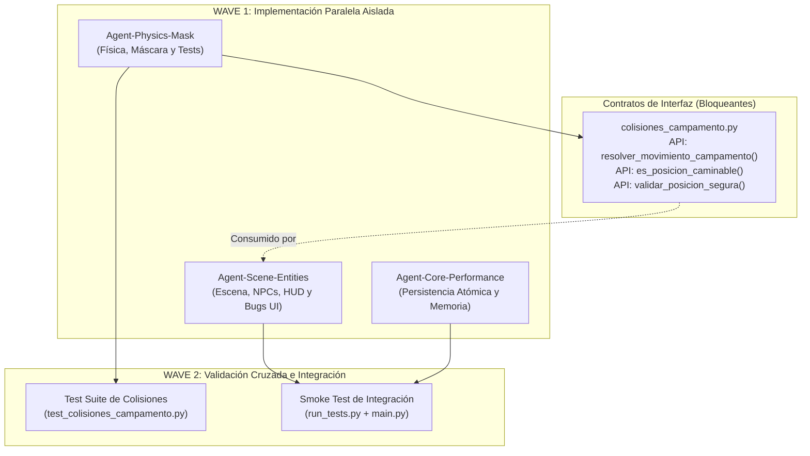

# Plan de Orquestación Multi-Agente: Migración de Escena, Colisiones por Máscara y Estabilización del Campamento

**Proyecto:** *Laberinto: El Umbral de Ceniza* (`lab_v2`)  
**Módulo:** Campamento (*Claro de Ceniza*)  
**Resolución Viewport:** Fija $1100 \times 720$ px (`ANCHO = 1100`, `ALTO = 720` en `lab_v2/interfaz/tema.py`)  
**Estrategia de Ejecución:** Paralela por Oleadas (*Waves*) con Aislamiento Estricto de Propiedad de Archivos (*Zero-Conflict*)

---

## 1. Topología de Agentes y Matriz de Propiedad de Archivos

Para evitar colisiones de Git y condiciones de carrera en disco, cada agente opera exclusivamente sobre un conjunto disjunto de archivos. Ningún agente puede modificar archivos asignados a otro.

$$\text{Archivos}(\text{Agent-Physics}) \cap \text{Archivos}(\text{Agent-Scene}) \cap \text{Archivos}(\text{Agent-Core}) = \emptyset$$



### Tabla de Propiedad Estricta

| Agente | Identificador | Rol Principal | Archivos Permitidos (Escritura Exclusiva) | Archivos Prohibidos (Solo Lectura o Sin Acceso) |
| :--- | :--- | :--- | :--- | :--- |
| **Agente 1** | `Agent-Physics-Mask` | Especialista en Visión/Máscaras, Físicas de Navegación y Suite de Pruebas Unitarias. | • `lab_v2/herramientas/procesar_mascara_campamento.py`<br>• `lab_v2/interfaz/colisiones_campamento.py`<br>• `lab_v2/pruebas/test_colisiones_campamento.py`<br>• Generación de `nav_campamento.png` (en raíz o ubicación resuelta) | • `lab_v2/interfaz/pantallas.py`<br>• `lab_v2/interfaz/app.py`<br>• `lab_v2/interfaz/ambiente.py`<br>• `lab_v2/interfaz/arte_pixel.py` |
| **Agente 2** | `Agent-Scene-Entities` | Especialista en Escena, Renderizado de Entidades, Y-Sorting, Indicadores HUD y Corrección de Bugs de Control/UI. | • `lab_v2/interfaz/pantallas.py` (exclusivamente la clase `Campamento` y métodos asociados) | • `lab_v2/interfaz/colisiones_campamento.py`<br>• `lab_v2/herramientas/*`<br>• `lab_v2/interfaz/app.py`<br>• `lab_v2/interfaz/ambiente.py`<br>• `lab_v2/interfaz/arte_pixel.py` |
| **Agente 3** | `Agent-Core-Performance` | Especialista en Persistencia Atómica, Gestión de Memoria, Optimización de Ciclo de Vida y Validación Global. | • `lab_v2/interfaz/app.py`<br>• `lab_v2/interfaz/ambiente.py`<br>• `lab_v2/interfaz/arte_pixel.py` | • `lab_v2/interfaz/pantallas.py`<br>• `lab_v2/interfaz/colisiones_campamento.py`<br>• `lab_v2/pruebas/*` |

---

## 2. Contratos de Interfaz Compartidos (API Freeze)

Ambos agentes consumidores (`Agent-Scene-Entities` y `Agent-Core-Performance`) asumen de forma estricta las siguientes firmas y constantes implementadas por `Agent-Physics-Mask` en `lab_v2/interfaz/colisiones_campamento.py`.

### 2.1. Constantes Canónicas de Coordenadas

```python
# Coordenadas maestras alineadas al nuevo fondo (1100 x 720)
COORD_UMBRAL: tuple[int, int]   = (550, 205)  # Punto focal de interacción del portón norte
COORD_HOGUERA: tuple[int, int]  = (550, 360)  # Centro del fuego (transitable libremente)
COORD_SPAWN: tuple[float, float] = (550.0, 560.0) # Posición inicial segura en el sendero sur

# Puestos de NPCs (ubicados en zonas transitables inmediatamente contiguas a sus mesas)
COORD_MARA: tuple[int, int]     = (315, 310)  # Cartógrafa (junto al atril/mapas oeste)
COORD_NELA: tuple[int, int]     = (315, 525)  # Curandera (junto al puesto de pociones suroeste)
COORD_TIZON: tuple[int, int]    = (755, 325)  # Duende (junto a reliquias/altar noreste)
COORD_IVO: tuple[int, int]      = (740, 510)  # Vigía (junto a armas/atalaya sureste)
```

### 2.2. Firmas de Funciones Exportadas

```python
def es_posicion_caminable(x: float, y: float, radio: int = 9) -> bool:
    """
    Evalúa si una coordenada (y su bounding box de radio dado) es transitable
    consultando la máscara binaria de navegación de 1100x720.
    Retorna True si el área está completamente libre de obstáculos; False en colisión o fuera de límites.
    """
    ...

def resolver_movimiento_campamento(
    pos_actual: list[float] | tuple[float, float],
    dx: float,
    dy: float,
    dt: float,
    velocidad: float = 190.0,
    radio: int = 9
) -> tuple[float, float, str, bool]:
    """
    Aplica física continua con deslizamiento independiente por ejes (Wall Sliding).
    Evalúa X e Y por separado para evitar atascos en diagonales y esquinas.
    Retorna: (nueva_x, nueva_y, direccion_cardinal, esta_andando)
    """
    ...

def validar_posicion_segura(
    pos_candidata: tuple[float, float] | list[float],
    fallback: tuple[float, float] = COORD_SPAWN
) -> tuple[float, float]:
    """
    Verifica si una posición cargada desde un archivo de guardado es transitable.
    Si colisiona con un obstáculo o está fuera del mapa, retorna la posición fallback segura.
    """
    ...

def dibujar_debug_colisiones(superficie: pygame.Surface, alpha: int = 120) -> None:
    """
    Superpone la máscara de colisiones en tiempo real sobre la superficie dada
    (rojo = sólido, verde/transparente = caminable) para pruebas de desarrollo.
    """
    ...
```

---

## 3. Plan de Ejecución por Oleadas (Waves)

---

### WAVE 1: Implementación Paralela Desacoplada (Sin Bloqueos)

```text
├── [T-01] [Agent-Physics-Mask] Extracción y generación de nav_campamento.png
├── [T-02] [Agent-Physics-Mask] Motor de colisiones por máscara (colisiones_campamento.py)
├── [T-03] [Agent-Scene-Entities] Limpieza de renderizado procedural y Y-Sorting (pantallas.py)
├── [T-04] [Agent-Scene-Entities] Reubicación de NPCs y corrección de bugs de interacción (pantallas.py)
├── [T-05] [Agent-Core-Performance] Persistencia atómica y clamp de coordenadas (app.py)
└── [T-06] [Agent-Core-Performance] Reutilización de buffers y recuperación de FPS (ambiente.py, arte_pixel.py)
```

#### `[T-01]` Pipeline de Extracción de Máscara de Navegación
* **Agente:** `Agent-Physics-Mask`
* **Archivos Objetivo:**
  * `lab_v2/herramientas/procesar_mascara_campamento.py` *(nuevo)*
  * Generación de `nav_campamento.png` (resolución canónica $1100 \times 720$)
* **Dependencias:** Ninguna (inicio inmediato).
* **Instrucciones Técnicas:**
  1. Localizar el asset de entrada `mascara_caminable` (`.jpg` o `.png`) fuera del directorio `lab_v2/` mediante búsqueda ascendente con `pathlib.Path(__file__).resolve()`. No utilizar rutas hardcodeadas.
  2. Implementar `lab_v2/herramientas/procesar_mascara_campamento.py`:
     - Cargar la imagen y asegurar dimensiones de $1100 \times 720$ px.
     - Filtrar el área caminable identificando los píxeles con predominancia verde ($G > 120$ y $G > R \times 1.2$ y $G > B \times 1.2$).
     - **Forzado de tránsito vital:** Pintar explícitamente como caminable el radio de la hoguera central (`cx=550, cy=360, radio=65`) y el pasillo de acceso frontal al Umbral (`x: 500-600, y: 170-240`).
     - Guardar la máscara optimizada de 1-bit / 8-bit en escala de grises como `nav_campamento.png` (blanco = 255 = transitable, negro = 0 = sólido).
  3. Ejecutar el script y verificar la creación física del archivo procesado.
* **Criterio de Verificación:**
  - El archivo `nav_campamento.png` existe, tiene dimensiones exactas de $1100 \times 720$ y el centro `(550, 360)` contiene píxeles de valor 255.

---

#### `[T-02]` Motor de Física de Navegación y Deslizamiento
* **Agente:** `Agent-Physics-Mask`
* **Archivos Objetivo:**
  * `lab_v2/interfaz/colisiones_campamento.py` *(reemplazo/actualización completa)*
* **Dependencias:** `[T-01]`
* **Instrucciones Técnicas:**
  1. Cargar `nav_campamento.png` usando `pygame.image.load` y convertirlo en un `pygame.Mask` o matriz de acceso rápido $O(1)$.
  2. Implementar `es_posicion_caminable(x, y, radio=9)`: comprobar los 4 vértices y el centro de la bounding box del viajero contra la máscara. Los límites de pantalla `0 <= x < 1100` e `y` deben respetarse estrictamente.
  3. Implementar `resolver_movimiento_campamento(...)`:
     - Normalizar vector `(dx, dy)` para evitar supervelocidad en diagonal.
     - Calcular desplazamiento `paso_x = dx * velocidad * dt` y `paso_y = dy * velocidad * dt`.
     - **Deslizamiento por ejes (*Wall Sliding*):** Evaluar `paso_x` manteniendo `y` constante; si es válido, aplicar `nueva_x`. Evaluar `paso_y` manteniendo `nueva_x`; si es válido, aplicar `nueva_y`. Esto garantiza desplazamiento fluido rozando muros sin frenado en seco.
     - Determinar dirección cardinal predominante y flag `andando`.
  4. Implementar `validar_posicion_segura(pos_candidata, fallback=COORD_SPAWN)`: si la posición colisiona con sólidos de la máscara, reubicar en `fallback`.
  5. Exportar `dibujar_debug_colisiones(superficie, alpha=120)`.
* **Criterio de Verificación:**
  - La función `resolver_movimiento_campamento` permite avanzar en diagonal a lo largo de un obstáculo vertical sin detener el avance en Y.

---

#### `[T-03]` Limpieza de Renderizado Procedural Obsoleto y Y-Sorting
* **Agente:** `Agent-Scene-Entities`
* **Archivos Objetivo:**
  * `lab_v2/interfaz/pantallas.py` (método `Campamento.dibujar`)
* **Dependencias:** Ninguna (puede comenzar en paralelo usando el contrato de la Sección 2).
* **Instrucciones Técnicas:**
  1. **Limpieza visual:** En `Campamento.dibujar()`, cuando el fondo ilustrado esté activo (`fondo_pixel.usa_imagen == True`), eliminar completamente el renderizado de primitivas procedurales obsoletas:
     - No dibujar la elipse verde del claro `(50, 138, 1000, 650)`.
     - No invocar `_dibujar_arbol()` para los 52 pinos procedurales.
     - No dibujar las carpas poligonales marrones, carros, mesas de madera ni cementerio procedural.
     - No dibujar la hoguera vectorial de base (el fondo ilustrado ya la contiene; solo superponer la llama viva pulsante de partículas).
  2. **Y-Sorting unificado (`SEC-14`):**
     - Crear una lista unificada de entidades a renderizar: viajero, Mara, Ivo, Nela, Tizón y armaduras.
     - Ordenar todas las entidades por su coordenada base $Y$ antes de dibujarlas: `entidades.sort(key=lambda e: e['y'])`.
     - Dibujar los rótulos y nombres de los NPCs inmediatamente vinculados a la entidad o tras el pixelado respetando la oclusión cuando el jugador camina por delante de ellos.
* **Criterio de Verificación:**
  - Inspección visual: El fondo ilustrado se visualiza limpio sin artefactos vectoriales superpuestos y el viajero pasa por detrás de un NPC cuando `viajero.y < npc.y` y por delante cuando `viajero.y > npc.y`.

---

#### `[T-04]` Reubicación de Entidades y Corrección de Bugs de Control e Interacción
* **Agente:** `Agent-Scene-Entities`
* **Archivos Objetivo:**
  * `lab_v2/interfaz/pantallas.py` (clase `Campamento`)
* **Dependencias:** `[T-02]` (o usar fallback de API de la Sección 2).
* **Instrucciones Técnicas:**
  1. **Alineación de Coordenadas:** Actualizar las posiciones de entidades a las constantes del contrato:
     - Umbral: `COORD_UMBRAL = (550, 205)`
     - Mara: `COORD_MARA = (315, 310)`
     - Nela: `COORD_NELA = (315, 525)`
     - Tizón: `COORD_TIZON = (755, 325)`
     - Ivo: `COORD_IVO = (740, 510)`
     - Spawn inicial: `COORD_SPAWN = (550.0, 560.0)`
  2. **Corrección de Bugs Identificados en Auditoría:**
     - `SEC-02` (*Sticky Keys*): En `Campamento.evento()`, escuchar `pygame.WINDOWFOCUSLOST` (o `ACTIVEEVENT` cuando `gain == 0`) y vaciar inmediatamente `self.teclas.clear()`.
     - `SEC-03` (*Armaduras Congeladas*): En el autómata de armaduras de `actualizar()`, asegurar que al volver a `"quieta"`, si `distancia >= 62`, se restablezca `armadura["activada"] = False` para permitir reactivaciones futuras.
     - `SEC-06` (*Mensaje Umbral*): Al interactuar con el Umbral, asignar `self.mensaje_tiempo = 3.5` (en vez de `0`) para que `"El Umbral se está abriendo..."` sea legible.
     - `SEC-08` (*Radios de Interacción*): Recalibrar distancias euclidianas en `_interactuar()` a radios de 75 px centrados en cada NPC para evitar solapamientos entre puestos contiguos.
     - `SEC-09` (*Trueque Tizón*): Exigir tecla `E` o confirmación explícita para comerciar fragmentos, evitando el consumo accidental con la barra espaciadora.
     - `SEC-11` (*Indicadores HUD Contextuales*): Actualizar dinámicamente la leyenda inferior del HUD indicando el objetivo próximo (`"E · HABLAR CON MARA"`, `"E · HABLAR CON NELA"`, `"E · TRUEQUE CON TIZÓN"`, etc.).
  3. **Integración del Movimiento:** Reemplazar el bucle de actualización de posición por la llamada directa a `colisiones_campamento.resolver_movimiento_campamento(...)`.
* **Criterio de Verificación:**
  - Al presionar `E` cerca del Umbral aparece el texto `"El Umbral se está abriendo..."`.
  - Al pulsar `Alt+Tab` en pleno movimiento y regresar, el personaje permanece detenido.

---

#### `[T-05]` Persistencia Atómica y Sanitización de Coordenadas
* **Agente:** `Agent-Core-Performance`
* **Archivos Objetivo:**
  * `lab_v2/interfaz/app.py`
* **Dependencias:** Ninguna (puede comenzar en paralelo).
* **Instrucciones Técnicas:**
  1. **Persistencia Atómica (`SEC-01`):**
     - En `App.guardar_checkpoint()`, escribir los datos serializados en un archivo temporal con sufijo `.tmp` (`checkpoint.json.tmp`) en el mismo directorio.
     - Ejecutar `temp_archivo.replace(archivo_final)` para asegurar atomicidad a nivel de sistema de archivos (POSIX y Windows NTFS), impidiendo archivos corruptos de 0 bytes ante cierres forzados.
  2. **Validación y Clamp de Checkpoint (`SEC-05`):**
     - En `App._cargar_checkpoint()`, validar que las coordenadas leídas sean numéricas finitas y acotarlas dentro del área transitable del campamento:
       `x = max(60.0, min(ANCHO - 60.0, float(datos["x"])))`
       `y = max(180.0, min(ALTO - 60.0, float(datos["y"])))`
     - Invocar `colisiones_campamento.validar_posicion_segura((x, y))` para reubicar al jugador en el punto de spawn si el checkpoint guardado quedó dentro de un collider nuevo.
* **Criterio de Verificación:**
  - Una prueba unitaria que simule interrupción durante el guardado no corrompe el archivo `checkpoint.json` preexistente.
  - Cargar un checkpoint con coordenadas inválidas `(-999, -999)` reubica al jugador en `(550.0, 560.0)`.

---

#### `[T-06]` Optimización de Memoria, Recuperación de FPS y Caché de Fondos
* **Agente:** `Agent-Core-Performance`
* **Archivos Objetivo:**
  * `lab_v2/interfaz/ambiente.py`
  * `lab_v2/interfaz/arte_pixel.py`
* **Dependencias:** Ninguna (puede comenzar en paralelo).
* **Instrucciones Técnicas:**
  1. **Reutilización de Superficies Alfa (`SEC-07` y `SEC-12`):**
     - En `arte_pixel.py` (`FondoRefugioPixel`), eliminar la asignación de `velo = pygame.Surface(..., pygame.SRCALPHA)` en cada cuadro dentro de `dibujar()`. Preinstanciar un buffer de niebla reutilizable en `__init__` y limpiar con `fill((0, 0, 0, 0))`.
     - En `app.py` (`_dibujar_transicion`), preinstanciar `self._velo_transicion = pygame.Surface((ANCHO, ALTO))` en el constructor y reutilizarla modificando solo `set_alpha()`.
  2. **Recuperación Dinámica de Calidad Gráfica (`SEC-10`):**
     - En `ambiente.py` (`AmbienteRefugio.actualizar()`), implementar recuperación automática de framerate:
       Si `self.calidad == 0` y la tasa de refresco se estabiliza por encima de 45 FPS (`self._dt_suave < 1 / 45`) durante más de 3.0 segundos acumulados, restaurar `self.calidad = 1` y reactivar niebla y partículas completas.
  3. **Optimización de Carga del Fondo:**
     - En `arte_pixel.py`, resolver dinámicamente la ruta de `fondo_campamento` o `LobbyWalppaper.jpg` inspeccionando la raíz del repositorio con `Path`. Convertir la superficie cargada al formato de pantalla con `.convert()` para maximizar el rendimiento del blit en hardware.
* **Criterio de Verificación:**
  - Ejecutar el juego y monitorizar la memoria: la tasa de recolección de basura se reduce drásticamente al eliminar la instanciación de superficies por cuadro.

---

### WAVE 2: Pruebas Unitarias, Validación Cruzada e Integración

```text
├── [T-07] [Agent-Physics-Mask] Suite de pruebas exhaustiva de máscara y colisiones
├── [T-08] [Agent-Physics-Mask & Agent-Scene-Entities] Validación cruzada de posiciones de NPCs
└── [T-09] [Agent-Core-Performance] Smoke Test de integración global del proyecto
```

#### `[T-07]` Suite de Pruebas Unitarias de Máscara y Navegación
* **Agente:** `Agent-Physics-Mask`
* **Archivos Objetivo:**
  * `lab_v2/pruebas/test_colisiones_campamento.py`
* **Dependencias:** `[T-01]`, `[T-02]`
* **Instrucciones Técnicas:**
  1. Actualizar `test_colisiones_campamento.py` utilizando `unittest` en modo *headless* (`SDL_VIDEODRIVER = "dummy"`):
     - `test_mascara_cargada_correctamente`: Verifica dimensiones $1100 \times 720$ px.
     - `test_hoguera_transitable`: Verifica que las coordenadas del centro del fuego `(550, 360)` y su perímetro inmediato son transitables (`es_posicion_caminable == True`).
     - `test_acceso_umbral_despejado`: Verifica camino continuo desde el claro hasta `(550, 205)`.
     - `test_obstaculos_solidos`: Verifica que las coordenadas de árboles exteriores, rocas norte y mesas devuelven `False`.
     - `test_wall_sliding_ejes`: Simula movimiento contra una pared vertical confirmando avance en Y.
     - `test_validar_posicion_segura`: Evalúa recuperación de puntos inválidos.
  2. Ejecutar suite con: `python -m unittest lab_v2/pruebas/test_colisiones_campamento.py -v`.
* **Criterio de Verificación:**
  - Todas las pruebas de `test_colisiones_campamento.py` pasan al 100% (OK) sin advertencias.

---

#### `[T-08]` Validación Cruzada de Posiciones de Entidades
* **Agentes Responsables:** `Agent-Physics-Mask` (ejecutor) con insumos de `Agent-Scene-Entities`.
* **Archivos Objetivo:**
  * `lab_v2/pruebas/test_colisiones_campamento.py`
* **Dependencias:** `[T-04]`, `[T-07]`
* **Instrucciones Técnicas:**
  1. Agregar pruebas de integración en `test_colisiones_campamento.py` que comprueben que cada una de las coordenadas oficiales de NPCs:
     - `COORD_MARA (315, 310)`
     - `COORD_NELA (315, 525)`
     - `COORD_TIZON (755, 325)`
     - `COORD_IVO (740, 510)`
     - `COORD_SPAWN (550, 560)`
     caen exactamente en píxeles transitables de la máscara (`es_posicion_caminable(x, y) == True`).
  2. Verificar que el radio de interacción de cada NPC no intersecte con el radio del NPC más cercano, garantizando que no haya solapamiento de diálogos (`SEC-08`).
* **Criterio de Verificación:**
  - Aprobación automatizada en tests de que ningún NPC quedó posicionado dentro de una roca, carpa o árbol sólido.

---

#### `[T-09]` Smoke Test y Validación Global de Integración
* **Agente:** `Agent-Core-Performance`
* **Archivos Objetivo:**
  * Integración general de `lab_v2/`
* **Dependencias:** `[T-01]` hasta `[T-08]` concluidas.
* **Instrucciones Técnicas:**
  1. Ejecutar la suite completa de pruebas del repositorio:
     ```powershell
     python lab_v2\run_tests.py
     ```
  2. Verificar que las 248+ pruebas del proyecto se ejecuten y finalicen exitosamente sin regresiones en las pantallas del laberinto ni en el campamento.
  3. Ejecutar arranque del juego en modo interactivo:
     ```powershell
     python lab_v2\main.py
     ```
     - Comprobar spawn en `(550, 560)`.
     - Caminar rodeando la hoguera libremente.
     - Interactuar con Mara, Nela, Ivo y Tizón.
     - Abrir el portón del Umbral y verificar transición a la pantalla de Niveles.
* **Criterio de Verificación:**
  - Salida de `run_tests.py`: `Ran 248+ tests ... OK`.
  - Cero congelamientos, cero atascos en el vacío y transiciones limpias.

---

## 4. Guía de Ejecución y Comandos de Referencia

### Ejecución de Pruebas Específicas del Campamento
```powershell
python -m unittest lab_v2\pruebas\test_colisiones_campamento.py -v
```

### Ejecución de Suite Global
```powershell
python lab_v2\run_tests.py
```

### Lanzamiento del Juego
```powershell
python lab_v2\main.py
```
