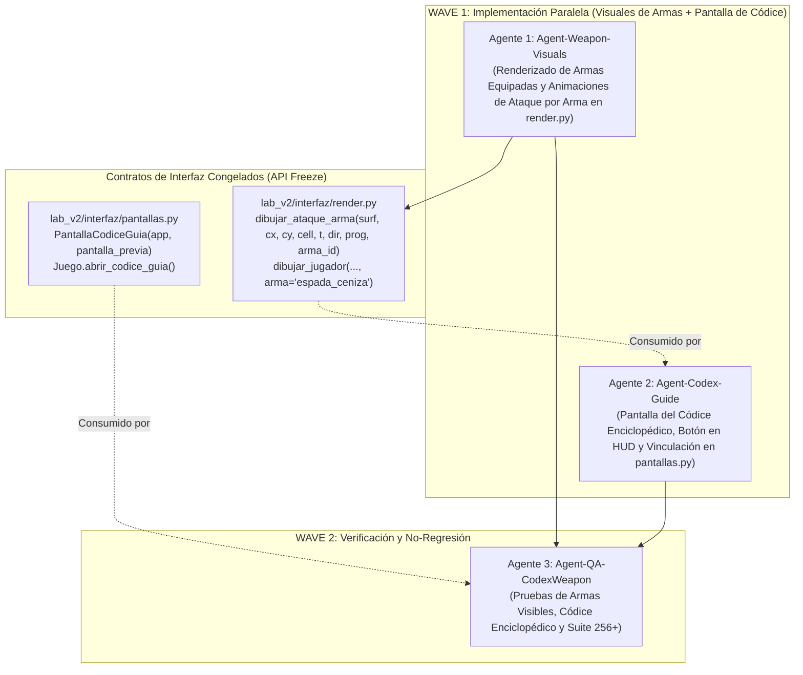

# Plan de Orquestación Multi-Agente: Visualización Dinámica de Armas Equipadas y Códice Enciclopédico de Mecánicas en Partida

**Proyecto:** *Laberinto: El Umbral de Ceniza* (`lab_v2`)  
**Módulos Afectados:** Motor de Renderizado Gráfico (`interfaz/render.py`), Pantallas e Interfaz de Juego (`interfaz/pantallas.py`), y Banco de Pruebas (`pruebas/test_codice_arma.py`).  
**Documento de Referencia:** Auditoría de Jugabilidad y Accesibilidad de Mecánicas.

---

## 1. Diagnóstico Técnico y Objetivos Fundamentales

### 1.1. Corrección del Bug de Armas Equipadas (Espadas que no se miran)
* **Causa Raíz Identificada:**
  1. En `lab_v2/interfaz/pantallas.py` (líneas 2480-2483), al ejecutar la animación de ataque, el juego llamaba rígidamente a `dibujar_espada_verde()` sin consultar qué arma tiene equipada el jugador en `self.app.inventario.arma_equipada`.
  2. En `lab_v2/interfaz/render.py` (`dibujar_jugador` y `_sprite_jugador`), el sprite del personaje dibuja fija una vaina verde sobre el cinturón, ignorando la Daga de Sombras o el Bastón de Centella.
* **Solución Técnica:**
  1. En `render.py`, implementar `dibujar_ataque_arma(surf, cx, cy, cell, t, direccion, progreso, arma_id)` con estética pixel-art distintiva para cada arma del catálogo:
     * **`espada_ceniza`:** Tajo amplio con estela de fuego verde esmeralda y chispas de ceniza.
     * **`daga_sombras`:** Tajo curvo veloz con estela de sombras púrpura/violeta umbría `(180, 70, 240)` y niebla nocturna.
     * **`baston_centella`:** Empuje arcano frontal con estallido cónico de centellas eléctricas y chispas celestes-doradas `(100, 230, 255)`.
  2. En `dibujar_jugador()`, incorporar el parámetro `arma="espada_ceniza"` y renderizar en el cinto/espalda la vaina o báculo correspondiente.
  3. En `Juego.dibujar()` y `Campamento.dibujar()`, pasar el arma activa obtenida de `self.app.inventario.arma_equipada`.

### 1.2. Nuevo Códice Enciclopédico de Mecánicas (Botón en Partida)
* **Objetivo:** Permitir al jugador abrir en cualquier momento de la partida (desde el panel derecho del HUD o con tecla rápida `C`) un **Códice / Guía del Laberinto** que explique detalladamente todo lo que puede aparecer en los niveles:
  1. **Trampas del Laberinto:**
     * *Placas de Presión (Marca de Tiza):* Despiertan un mecanismo de colapso con tiempo límite para regresar a la marca segura.
     * *Rotor de Cuchillas:* Aspas giratorias; esperar el destello verde o saltar con `Espacio`.
     * *Péndulo de Cadena:* Maza oscilante; esperar a que se aparte o saltar con `Espacio`.
     * *Rueda de Hierro:* Rodillo pesado que recorre el carril; salir de su trayectoria.
     * *Púas Emergentes:* Dientes de acero; saltar con `Espacio`.
  2. **Presencias y Entidades:**
     * *Orbe Carmesí (Radar):* Esfera roja latente que recorre el laberinto por la ruta más corta (BFS). Si toca al viajero, le drena 5 movimientos valiosos y regresa a su origen.
     * *El Eco (Sombra del Viajero):* Espectro que reproduce tus pasos anteriores con N turnos de retraso. Si te alcanza, quedas consumido.
     * *Esqueletos Guardianes:* Patrullan las catacumbas; atacan al verte a corta distancia. Se les puede atacar de frente con el arma equipada.
  3. **Coleccionables y Meta:**
     * *Estrellas de Oro:* 3 por nivel en ramales ciegos. Otorgan +150 pts y calificación de 3 estrellas (★★★).
     * *Cofres de Botín:* Desbloquean armas, armaduras y habilidades para el inventario, o bolsas de oro.
     * *El Umbral:* La puerta de escape final.
* **Integración en HUD:**
  - Agregar botón dedicado `Códice / Guía [C]` en el panel lateral derecho de `Juego` (reorganizando la botonera vertical).
  - Renombrar el botón actual a `Inventario [I]` para separar claramente la gestión de equipamiento del códice de mecánicas.

---

## 2. Topología de Agentes y Matriz de Propiedad Estricta (Zero-Conflict)

$$\text{Archivos}(\text{Agent-Weapon-Visuals}) \cap \text{Archivos}(\text{Agent-Codex-Guide}) \cap \text{Archivos}(\text{Agent-QA-CodexWeapon}) = \emptyset$$



### Tabla de Propiedad Exclusiva de Archivos

| Agente | Identificador | Rol Especializado | Modelo Recomendado | Archivos de Escritura Exclusiva | Archivos de Solo Lectura |
| :--- | :--- | :--- | :--- | :--- | :--- |
| **Agente 1** | `Agent-Weapon-Visuals` | Artista Técnico e Ingeniero de Renderizado. | `Claude Sonnet 5.5 (Medium)` | • `lab_v2/interfaz/render.py` | • `lab_v2/juego/inventario.py`<br>• `lab_v2/interfaz/pantallas.py` |
| **Agente 2** | `Agent-Codex-Guide` | Diseñador de Interfaz, HUD y Enciclopedia de Juego. | `Claude Sonnet 5.5 (Medium)` / `Gemini 4 Argon` | • `lab_v2/interfaz/pantallas.py` | • `lab_v2/interfaz/render.py`<br>• `lab_v2/juego/peligros.py`<br>• `lab_v2/juego/radar.py` |
| **Agente 3** | `Agent-QA-CodexWeapon` | Ingeniero de Calidad y Pruebas de Integración. | `Claude Sonnet 5.5 (Medium)` | • `lab_v2/pruebas/test_codice_arma.py` *(nuevo)* | • Todos los módulos de `lab_v2/*` |

---

## 3. Contratos de Interfaz Compartidos (API Freeze)

### 3.1. API de Renderizado de Armas (`lab_v2/interfaz/render.py`)

```python
def dibujar_ataque_arma(surf, cx, cy, cell, t, direccion, progreso, arma_id="espada_ceniza"):
    """
    Dibuja el efecto de corte o ataque en pixel art según el arma equipada:
    - 'espada_ceniza': Tajo de fuego verde espectral (75, 221, 104).
    - 'daga_sombras': Tajo curvo de sombras y estela púrpura (180, 70, 240).
    - 'baston_centella': Estallido frontal de centellas eléctricas celestes-doradas (100, 230, 255).
    """
    ...

def dibujar_jugador(surf, cx, cy, cell, t, antorcha=True, direccion="abajo",
                    andando=False, saltando=False, arma="espada_ceniza"):
    """
    Dibuja al viajero reflejando el color y forma del arma enfundada en el cinto o espalda.
    """
    ...
```

### 3.2. Pantalla de Códice y Botón en HUD (`lab_v2/interfaz/pantallas.py`)

```python
class PantallaCodiceGuia(Pantalla):
    """
    Guía enciclopédica interactiva de mecánicas, trampas, entidades y coleccionables.
    Accesible en cualquier momento con C o desde el HUD lateral.
    """
    def __init__(self, app, pantalla_previa):
        ...
```

---

## 4. Plan de Ejecución por Oleadas (Waves)

```text
├── WAVE 1 (Completada y Fusionada en Master):
│   ├── [COMPLETADO] [Agent-Weapon-Visuals] Efectos de Ataque y Sprites Dinámicos por Arma (render.py)
│   └── [COMPLETADO] [Agent-Codex-Guide] Pantalla del Códice de Mecánicas y Botón en HUD (pantallas.py)
└── WAVE 2 (Lista para Ejecución):
    └── [EN PROCESO] [Agent-QA-CodexWeapon] Banco de Pruebas de Armas y Códice del Laberinto (test_codice_arma.py)
```

---

### WAVE 1: Implementación Paralela (Visuales de Armas + Pantalla de Códice)

#### `[T-01]` Efectos de Ataque y Sprites Dinámicos por Arma
* **Agente Asignado:** `Agent-Weapon-Visuals`
* **Modelo Recomendado:** `Claude Sonnet 5.5 (Medium)`
* **Archivos de Escritura Exclusiva:** `lab_v2/interfaz/render.py`
* **Instrucciones Técnicas:**
  1. Mantener retrocompatibilidad con `dibujar_espada_verde` redirigiéndola internamente a `dibujar_ataque_arma(..., arma_id="espada_ceniza")`.
  2. Implementar `dibujar_ataque_arma(surf, cx, cy, cell, t, direccion, progreso, arma_id)`:
     * Si `arma_id == "espada_ceniza"`: renderizar el corte verde esmeralda espectral existente con chispas de ceniza.
     * Si `arma_id == "daga_sombras"`: renderizar un tajo rápido en medialuna con filo de obsidiana, estela púrpura umbría `(180, 70, 240)` y partículas de niebla nocturna.
     * Si `arma_id == "baston_centella"`: renderizar el extremo de la vara arcana emitiendo un destello concentrado con arco eléctrico cian `(100, 230, 255)` y chispas doradas.
  3. Modificar `_sprite_jugador` y `dibujar_jugador` para aceptar el parámetro opcional `arma="espada_ceniza"`:
     * Incluir el tipo de arma en la clave del caché `_sprites_jugador`.
     * Si el arma es `daga_sombras`, dibujar una empuñadura compacta de filo morado.
     * Si el arma es `baston_centella`, dibujar la vara de madera rúnica con gema celeste.
     * Si el arma es `espada_ceniza`, dibujar la clásica empuñadura de hoja verde.

#### `[T-02]` Pantalla del Códice de Mecánicas y Botón en HUD
* **Agente Asignado:** `Agent-Codex-Guide`
* **Modelo Recomendado:** `Claude Sonnet 5.5 (Medium)` / `Gemini 4 Argon`
* **Archivos de Escritura Exclusiva:** `lab_v2/interfaz/pantallas.py`
* **Instrucciones Técnicas:**
  1. **Visualización del arma equipada en partida y campamento:**
     * En `Juego.dibujar()` y `Campamento.dibujar()`, obtener `arma_activa = getattr(self.app.inventario, "arma_equipada", "espada_ceniza")`.
     * Pasar `arma=arma_activa` a `dibujar_jugador()`.
     * En la animación de ataque (`self.ataque_animacion > 0`), llamar a `dibujar_ataque_arma(..., arma_id=arma_activa)`.
  2. **Creación de `PantallaCodiceGuia`:**
     * Pantalla interactiva en 2 paneles:
       - **Panel Izquierdo:** Lista de elementos agrupados en 3 categorías (Trampas, Presencias/Entidades, Coleccionables/Meta).
       - **Panel Derecho:** Ficha detallada con dibujo o icono, nombre, descripción de qué hace y consejo táctico de **cómo evadirlo o aprovecharlo** (incluyendo el Orbe Carmesí/Radar, la Sombra/Eco, Esqueletos y las 5 trampas).
     * Navegación fluida con clic de mouse y flechas/WASD con sonido `hover`.
     * Tecla `Esc` o botón "Cerrar / Volver" regresa inmediatamente a la partida o pantalla previa sin reiniciar el estado.
  3. **Integración en el HUD derecho de `Juego`:**
     * Reorganizar la botonera vertical del HUD:
       - `Pista [H]`
       - `Deshacer [U]`
       - `Antorcha [L]`
       - `Inventario [I]`
       - `Códice [C]` *(nuevo botón interactivo)*
       - `Pausa [Esc]`
     * Vincular la tecla `K_c` en `Juego.evento(e)` para abrir el Códice de inmediato.
     * Añadir botón en el menú de pausa (`Pausa`) para acceder también al Códice.

---

### WAVE 2: Verificación y No-Regresión

#### `[T-03]` Banco de Pruebas de Armas y Códice del Laberinto
* **Agente Asignado:** `Agent-QA-CodexWeapon`
* **Modelo Recomendado:** `Claude Sonnet 5.5 (Medium)`
* **Archivos de Escritura Exclusiva:** `lab_v2/pruebas/test_codice_arma.py`
* **Instrucciones Técnicas:**
  1. Crear `lab_v2/pruebas/test_codice_arma.py`:
     - `test_render_ataque_por_arma`: Verificar que `dibujar_ataque_arma` renderiza sin fallos para `espada_ceniza`, `daga_sombras` y `baston_centella`.
     - `test_sprite_jugador_con_armas`: Verificar que `dibujar_jugador` genera sprites distintos según el arma provista.
     - `test_pantalla_codice_guia_navegacion`: Validar apertura, cambio de categoría y retorno limpio a la partida.
     - `test_boton_codice_en_juego`: Verificar que la tecla `C` y el botón del HUD abren `PantallaCodiceGuia`.
  2. Ejecutar la suite completa:
     `$env:PYTHONPATH="lab_v2"; python -m unittest discover -s lab_v2/pruebas`
     Asegurar 256+ pruebas pasando con 0 errores y 0 fallos.

---

## 5. Asignación de Agentes, Modelos y Prompts de Ejecución

### Resumen de Recursos Necesarios
* **Total de Agentes:** 3 agentes en 2 oleadas (Wave 1: 2 agentes paralelos; Wave 2: 1 agente de control de calidad).
* **Modelos Aptos:**
  - `Claude Sonnet 5.5 (Medium)` para renderizado gráfico y suite de pruebas.
  - `Claude Sonnet 5.5 (Medium)` o `Gemini 4 Argon` para pantallas y HUD interactivo.

---

### 📋 PROMPT LISTO PARA AGENTE 1 (`Agent-Weapon-Visuals`)
```text
Rol: Agent-Weapon-Visuals (Artista Técnico e Ingeniero de Renderizado)
Modelo Recomendado: Claude Sonnet 5.5 (Medium)
Archivos de Escritura Exclusiva:
- lab_v2/interfaz/render.py
Archivos de Solo Lectura:
- lab_v2/juego/inventario.py
- lab_v2/interfaz/pantallas.py

Tu misión es implementar la representación visual de las diferentes armas equipadas y sus ataques en render.py:
1. En lab_v2/interfaz/render.py, implementa dibujar_ataque_arma(surf, cx, cy, cell, t, direccion, progreso, arma_id="espada_ceniza"):
   - Si arma_id == "espada_ceniza": conserva el tajo de fuego verde esmeralda y chispas.
   - Si arma_id == "daga_sombras": genera un tajo ágil y curvo de estela púrpura/violeta umbría (180, 70, 240) con niebla nocturna.
   - Si arma_id == "baston_centella": genera un destello y haz frontal de centellas eléctricas cian (100, 230, 255) y chispas doradas.
   - Mantén la función dibujar_espada_verde llamando internamente a dibujar_ataque_arma(..., arma_id="espada_ceniza") para retrocompatibilidad.
2. Modifica dibujar_jugador y _sprite_jugador para aceptar arma="espada_ceniza":
   - Añade el arma a la clave del caché _sprites_jugador.
   - Dibuja en el personaje la vaina o arma correspondiente: filo morado para daga_sombras, vara arcana con gema celeste para baston_centella, y filo verde para espada_ceniza.
3. Respeta tu titularidad exclusiva (solo lab_v2/interfaz/render.py) y notifica el freeze de la API al terminar.
```

---

### 📋 PROMPT LISTO PARA AGENTE 2 (`Agent-Codex-Guide`)
```text
Rol: Agent-Codex-Guide (Diseñador de Interfaz, HUD y Enciclopedia de Juego)
Modelo Recomendado: Claude Sonnet 5.5 (Medium) / Gemini 4 Argon
Archivos de Escritura Exclusiva:
- lab_v2/interfaz/pantallas.py
Archivos de Solo Lectura:
- lab_v2/interfaz/render.py
- lab_v2/juego/peligros.py
- lab_v2/juego/radar.py

Tu misión es conectar la visualización de armas activas y crear la nueva pantalla del Códice de Mecánicas del Laberinto:
1. Conexión del arma activa en partida y campamento:
   - En Juego.dibujar() y Campamento.dibujar(), consulta el arma equipada: arma_activa = getattr(self.app.inventario, "arma_equipada", "espada_ceniza").
   - Pásala a dibujar_jugador(..., arma=arma_activa).
   - En la animación de ataque (ataque_animacion > 0), invoca dibujar_ataque_arma(..., arma_id=arma_activa) en lugar de la llamada estática anterior.
2. Crear PantallaCodiceGuia(Pantalla):
   - Una guía/enciclopedia del laberinto con dos paneles interactivos:
     * Panel izquierdo: lista de elementos organizados en categorías (Trampas, Entidades, Coleccionables).
     * Panel derecho: ficha ilustrada con nombre, icono/dibujo, descripción de qué es, qué hace y consejos tácticos de cómo evadirlo o aprovecharlo.
     * Incluir obligatoriamente: el Orbe Carmesí (Radar que persigue por BFS y drena 5 movimientos), el Eco (Sombra que reproduce pasos previos), Esqueletos, y las 5 trampas (placas de tiza, rotor, péndulo, rueda de hierro, púas).
     * Soporte de navegación con mouse, hover y flechas/WASD. Botón Volver y tecla Esc para retornar limpiamente al estado de juego previo.
3. Integrar en el HUD de Juego:
   - Añadir el botón "Códice [C]" en el menú lateral derecho de Juego, reorganizando los botones para que encajen de forma limpia (Pista, Deshacer, Antorcha, Inventario [I], Códice [C], Pausa).
   - Permitir abrirlo en cualquier momento pulsando la tecla C.
   - Añadir también el acceso al Códice en el menú de Pausa.
4. Respeta tu titularidad exclusiva (solo lab_v2/interfaz/pantallas.py).
```

---

### 📋 PROMPT LISTO PARA AGENTE 3 (`Agent-QA-CodexWeapon`)
```text
Rol: Agent-QA-CodexWeapon (Ingeniero de Calidad y Pruebas de Integración)
Modelo Recomendado: Claude Sonnet 5.5 (Medium)
Archivos de Escritura Exclusiva:
- lab_v2/pruebas/test_codice_arma.py
Archivos de Solo Lectura:
- Todos los módulos de lab_v2/*

Tu misión es verificar formalmente los ataques de armas y la nueva pantalla de Códice:
1. Crea lab_v2/pruebas/test_codice_arma.py con pruebas unitarias y de integración:
   - test_render_armas_distintas: Verifica que dibujar_ataque_arma renderiza correctamente para espada_ceniza, daga_sombras y baston_centella sin lanzar excepciones.
   - test_sprite_jugador_con_armas: Verifica que dibujar_jugador genera sprites diferenciados según el arma equipada.
   - test_pantalla_codice_elementos: Valida que PantallaCodiceGuia contiene y describe el Radar (Orbe Carmesí), Eco, trampas y coleccionables.
   - test_acceso_codice_en_juego: Verifica que Juego permite abrir PantallaCodiceGuia mediante tecla K_c y botón del HUD.
2. Ejecuta la suite completa de pruebas:
   $env:PYTHONPATH="lab_v2"; python -m unittest discover -s lab_v2/pruebas
   Verifica que los 256 tests previos más los nuevos pasen con 0 errores y 0 fallos.
```
