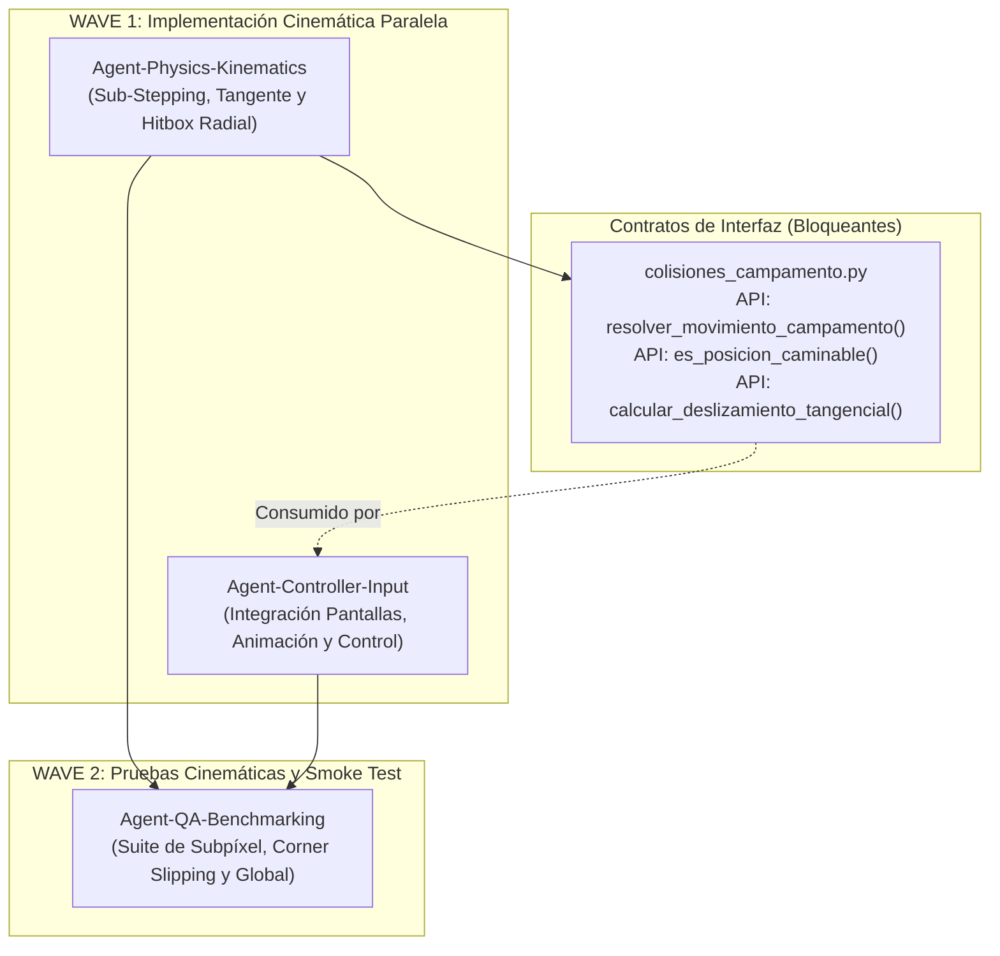

# Plan de Orquestación Multi-Agente: Cinemática Suave, Deslizamiento en Muros (Wall Sliding), Sub-Stepping y Asistencia de Esquinas (Corner Slipping)

**Proyecto:** *Laberinto: El Umbral de Ceniza* (`lab_v2`)  
**Módulo:** Campamento (*Claro de Ceniza*) — Motor de Físicas y Cinemática del Viajero  
**Objetivo:** Eliminar por completo la sensación de frenado en seco y atascos contra objetos del escenario mediante:
1. **Aproximación Continua (Sub-Stepping):** Cierre de distancia subpíxel hasta el borde del colisionador (< 0.25 px).
2. **Deslizamiento Tangencial Automático (Wall Sliding Real):** Conservación y redirección del 100% del momento sobre superficies diagonales y curvas.
3. **Hitbox Redondeada y Asistencia de Esquinas (Corner Slipping):** Muestreo radial en los pies y empuje tangencial suave para rodear aristas de mesas, rocas y carpas sin trabarse.

---

## 1. Topología de Agentes y Matriz de Propiedad Estricta (Zero-Conflict)

Para garantizar paralelismo real sin conflictos de Git ni condiciones de carrera, cada agente tiene la propiedad exclusiva sobre un conjunto disjunto de archivos:

$$\text{Archivos}(\text{Kinematics}) \cap \text{Archivos}(\text{Controller}) \cap \text{Archivos}(\text{QA}) = \emptyset$$



### Tabla de Propiedad Exclusiva de Archivos

| Agente | Identificador | Rol Especializado | Archivos Permitidos (Escritura Exclusiva) | Archivos Prohibidos (Solo Lectura) |
| :--- | :--- | :--- | :--- | :--- |
| **Agente 1** | `Agent-Physics-Kinematics` | Especialista en Cinemática 2D, Búsqueda Binaria Subpíxel y Muestreo Radial. | • `lab_v2/interfaz/colisiones_campamento.py`<br>• `lab_v2/herramientas/procesar_mascara_campamento.py` | • `lab_v2/interfaz/pantallas.py`<br>• `lab_v2/interfaz/controlador_campamento.py`<br>• `lab_v2/pruebas/*` |
| **Agente 2** | `Agent-Controller-Input` | Especialista en Control de Juego, Sincronización de Sprites y Ciclo de Animación. | • `lab_v2/interfaz/pantallas.py`<br>• `lab_v2/interfaz/controlador_campamento.py` | • `lab_v2/interfaz/colisiones_campamento.py`<br>• `lab_v2/pruebas/*`<br>• `lab_v2/interfaz/app.py` |
| **Agente 3** | `Agent-QA-Benchmarking` | Especialista en Pruebas Físicas de Tolerancia Epsilon, Validación de Esquinas y Smoke Test. | • `lab_v2/pruebas/test_colisiones_campamento.py`<br>• `lab_v2/pruebas/test_controlador_campamento.py` | • Todos los archivos de código fuente en `lab_v2/interfaz/*` y `lab_v2/herramientas/*` |

---

## 2. Contratos de Interfaz Compartidos (API Freeze)

Tanto `Agent-Controller-Input` como `Agent-QA-Benchmarking` consumirán de forma estricta las siguientes firmas actualizadas en `lab_v2/interfaz/colisiones_campamento.py`:

```python
def es_posicion_caminable(x: float, y: float, radio: float = 7.5, muestreo_radial: bool = True) -> bool:
    """
    Evalúa si la coordenada (x, y) es transitable usando una hitbox redondeada en los pies.
    Si muestreo_radial es True, comprueba el centro y 8 puntos equidistantes en el perímetro
    circular para evitar trabas en esquinas de 90° de la rejilla de píxeles.
    """
    ...

def resolver_movimiento_campamento(
    pos_actual: list[float] | tuple[float, float],
    dx: float,
    dy: float,
    dt: float,
    velocidad: float = 190.0,
    radio: float = 7.5,
    permitir_corner_slip: bool = True
) -> tuple[float, float, str, bool]:
    """
    Resuelve el movimiento aplicando:
    1. Sub-Stepping: Aproxima la posición hasta la superficie con precisión <= 0.25 px.
    2. Wall Sliding Real: Transfiere el 100% de la velocidad al eje libre en diagonales.
    3. Corner Slipping: Si el personaje choca contra una esquina con más del 60% del cuerpo
       despejado, aplica un micro-empuje tangencial (1-3 px) para rodear el obstáculo suavemente.
    Retorna: (nueva_x, nueva_y, direccion_cardinal, esta_andando)
    """
    ...
```

---

## 3. Plan de Ejecución por Oleadas (Waves)

---

### WAVE 1: Implementación Paralela de Cinemática y Control

```text
├── [T-01] [Agent-Physics-Kinematics] Hitbox radial y algoritmo de Sub-Stepping binario
├── [T-02] [Agent-Physics-Kinematics] Deslizamiento tangencial real y Corner Slipping
└── [T-03] [Agent-Controller-Input] Sincronización de controlador, rumbos y animación de marcha
```

#### `[T-01]` Hitbox Radial y Algoritmo de Sub-Stepping Binario
* **Agente:** `Agent-Physics-Kinematics`
* **Archivos Objetivo:**
  * `lab_v2/interfaz/colisiones_campamento.py`
* **Dependencias:** Inicio inmediato.
* **Instrucciones Técnicas:**
  1. **Hitbox Radial en los Pies:** Modificar `es_posicion_caminable` para que la colisión del viajero represente la elipse/círculo de apoyo de sus pies (radio calibrado a $7.5$ px). En lugar de comprobar los 4 vértices a 90° de un cuadrado, muestrear:
     - Centro `(ix, iy)`.
     - 4 puntos cardinales a distancia $r$: `(ix ± r, iy)` y `(ix, iy ± r)`.
     - 4 puntos diagonales a distancia $r \times \frac{\sqrt{2}}{2} \approx 0.707 r$.
  2. **Sub-Stepping Continuo por Ejes:**
     - Implementar `_aproximar_eje(x, y, paso, es_x, radio)`: si el paso completo `x + paso` colisiona, no descartar el movimiento a 0.
     - Ejecutar una búsqueda binaria rápida (5 iteraciones, costo despreciable $O(1)$) en el intervalo $[0, |\text{paso}|]$ para encontrar la distancia máxima transitable antes del contacto.
     - Esto permite al viajero avanzar los $0.5$ px, $1.2$ px o $2.8$ px restantes hasta posarse exactamente contra la superficie de árboles, mesas o carpas.
* **Criterio de Verificación:**
  - Al caminar de frente hacia un muro, el personaje queda situado a menos de $0.5$ px del límite sólido sin frenarse a distancia visible.

---

#### `[T-02]` Deslizamiento Tangencial Real y Corner Slipping
* **Agente:** `Agent-Physics-Kinematics`
* **Archivos Objetivo:**
  * `lab_v2/interfaz/colisiones_campamento.py`
* **Dependencias:** `[T-01]`
* **Instrucciones Técnicas:**
  1. **Conservación de Momento en Deslizamiento:**
     - En `resolver_movimiento_campamento`: cuando una trayectoria diagonal (`dx != 0` y `dy != 0`) encuentra un bloqueo en el eje X, transferir la magnitud completa de la velocidad al eje Y (`paso_y = sign(dy) * velocidad * dt`), y viceversa.
     - Evitar la penalización al $70.7\%$ de velocidad cuando un eje está restringido, garantizando que el personaje patine por las paredes a velocidad de carrera completa ($190$ px/s).
  2. **Asistencia de Esquinas (Corner Slipping):**
     - Si una dirección puramente cardinal (por ejemplo, solo `D` hacia la derecha) colisiona frontalmente con un obstáculo:
     - Evaluar si un micro-desplazamiento lateral de $\pm 2$ a $\pm 4$ px en el eje ortogonal (arriba o abajo) permite sortear el obstáculo.
     - Si solo un extremo de la hitbox roza la esquina (arista de mesa, bordón de tienda), inyectar un componente suave en el eje libre para rodear la esquina sin exigir que el jugador cambie manualmente de tecla.
* **Criterio de Verificación:**
  - Correr hacia la derecha presionando solo `D` contra la esquina superior de una mesa hace que el personaje se deslice automáticamente hacia arriba y continúe su camino sin detenerse.

---

#### `[T-03]` Sincronización de Controlador, Rumbos y Animación de Marcha
* **Agente:** `Agent-Controller-Input`
* **Archivos Objetivo:**
  * `lab_v2/interfaz/pantallas.py`
  * `lab_v2/interfaz/controlador_campamento.py`
* **Dependencias:** Contrato de la Sección 2.
* **Instrucciones Técnicas:**
  1. **Alineación de Orientación del Sprite:**
     - En `Campamento.actualizar()` y `ControladorCampamento.actualizar()`: si el jugador presiona `W+D` pero el eje X está bloqueado contra un muro vertical, la orientación visual del viajero debe mantenerse coherente con la intención de movimiento del jugador o con el vector de deslizamiento efectivo.
  2. **Consistencia de Estado:**
     - Asegurar que `self.controlador.posicion` y `self.personaje` compartan la misma tupla de coordenadas redondeadas/flotantes generadas por `resolver_movimiento_campamento`.
     - Garantizar que el flag `andando` permanezca en `True` mientras el viajero se esté deslizando por una pared, reproduciendo los pasos y partículas de polvo en los pies sin tartamudeos visuales.
* **Criterio de Verificación:**
  - El ciclo de caminata y las partículas de polvo se reproducen de forma continua y fluida mientras el personaje resbala a lo largo de cualquier muro del claro.

---

### WAVE 2: Pruebas Unitarias de Cinemática, Benchmarking y Smoke Test

```text
├── [T-04] [Agent-QA-Benchmarking] Suite de pruebas cinemáticas (Sub-Stepping y Slipping)
├── [T-05] [Agent-QA-Benchmarking] Validación de esquinas y no-atasco en puestos de NPCs
└── [T-06] [Agent-QA-Benchmarking] Smoke Test de integración global (run_tests.py)
```

#### `[T-04]` Suite de Pruebas Cinemáticas de Tolerancia y Deslizamiento
* **Agente:** `Agent-QA-Benchmarking`
* **Archivos Objetivo:**
  * `lab_v2/pruebas/test_colisiones_campamento.py`
  * `lab_v2/pruebas/test_controlador_campamento.py`
* **Dependencias:** `[T-01]`, `[T-02]`, `[T-03]` concluidas.
* **Instrucciones Técnicas:**
  1. En `test_colisiones_campamento.py`, agregar casos de prueba específicos:
     - `test_substepping_aproximacion_milimetrica`: Verificar que ante un muro ubicado a $1.5$ px de distancia, un paso de $3.0$ px desplace al personaje exactamente $1.5$ px en lugar de $0.0$ px.
     - `test_conservacion_velocidad_deslizamiento`: Verificar que el avance en el eje libre durante una colisión diagonal conserve la velocidad completa ($190 \times dt$).
     - `test_corner_slipping_esquinas`: Simular impacto contra una esquina y comprobar que el personaje se desvíe automáticamente al espacio libre.
  2. Ejecutar con: `python -m unittest lab_v2/pruebas/test_colisiones_campamento.py -v`.
* **Criterio de Verificación:**
  - 100% de las pruebas cinemáticas aprobadas.

---

#### `[T-05]` Validación de Esquinas en Obstáculos del Claro y Puestos de NPCs
* **Agente:** `Agent-QA-Benchmarking`
* **Archivos Objetivo:**
  * `lab_v2/pruebas/test_colisiones_campamento.py`
* **Dependencias:** `[T-04]`
* **Instrucciones Técnicas:**
  1. Crear un test de trayectoria cerrada (recorrido perimetral simulado de 360°) alrededor de la hoguera central `(550, 360)` y de las carpas de Mara y Nela.
  2. Confirmar que en ninguna coordenada de la trayectoria el personaje sufra detención por colisión frontal en bordes diagonales.
* **Criterio de Verificación:**
  - Cero atascos en los 360° de giro alrededor de todos los elementos interactivos del campamento.

---

#### `[T-06]` Smoke Test Global de Integración del Proyecto
* **Agente:** `Agent-QA-Benchmarking`
* **Archivos Objetivo:**
  * Integración general de `lab_v2/`
* **Dependencias:** `[T-01]` a `[T-05]` completadas.
* **Instrucciones Técnicas:**
  1. Ejecutar la suite general completa:
     ```powershell
     python lab_v2\run_tests.py
     ```
  2. Verificar que las 229+ pruebas del juego finalicen en estado `OK` sin ninguna regresión en el laberinto, pantallas o sistemas de guardado.
* **Criterio de Verificación:**
  - Salida: `Ran 229+ tests ... OK`.

---

## 4. Guía de Ejecución y Comandos de Prueba

### Pruebas Cinemáticas Específicas
```powershell
python -m unittest lab_v2\pruebas\test_colisiones_campamento.py -v
```

### Pruebas de Controlador y Movimiento
```powershell
python -m unittest lab_v2\pruebas\test_controlador_campamento.py -v
```

### Smoke Test Completo
```powershell
python lab_v2\run_tests.py
```

### Lanzamiento Directo del Juego para Prueba de Usuario
```powershell
& "C:\Users\xgome\AppData\Local\Programs\Python\Python312\python.exe" lab_v2\main.py
```
