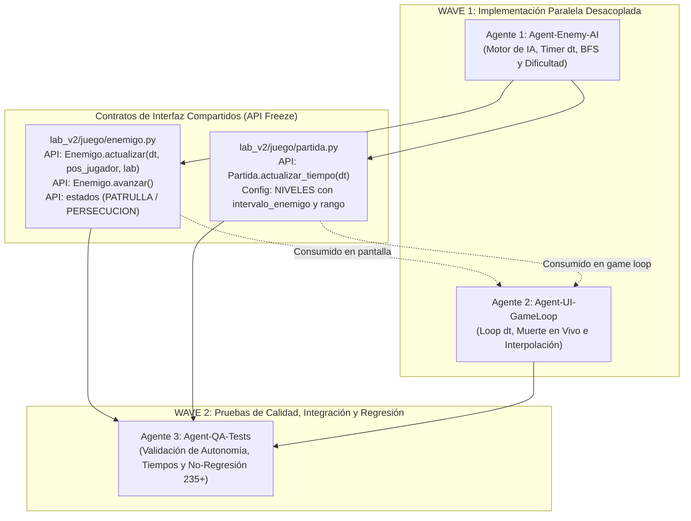

# Plan de Orquestación Multi-Agente: Movimiento Autónomo en Tiempo Real e Inteligencia Escalar de Enemigos por Dificultad

**Proyecto:** *Laberinto: El Umbral de Ceniza* (`lab_v2`)  
**Módulos Afectados:** Motor de IA (`juego/enemigo.py`), Núcleo de Partida (`juego/partida.py`), Ciclo de Pantallas (`interfaz/pantallas.py`), Efectos Ambientales (`interfaz/ambiente_laberinto.py`) y Pruebas Unitarias (`pruebas/test_enemigo.py`, `pruebas/test_partida.py`).  
**Objetivo Fundamental:**
1. **Desacoplar el movimiento de los enemigos del turno del jugador:** Los enemigos estándar ya no esperarán a que el jugador presione una tecla para avanzar; se moverán de forma continua y autónoma en tiempo real acumulando delta time ($dt$).
2. **Implementar Inteligencia de Caza Adaptativa (Máquina de Estados Finitos):** Los enemigos alternarán entre estados de `PATRULLA` (recorriendo su `ListaCircular`), `ALERTA` y `PERSECUCION` (calculando la ruta más corta hacia el jugador mediante BFS en las casillas transitables del laberinto).
3. **Escalado Dinámico por Dificultad:** La velocidad de paso ($dt$) y la agresividad/rango de detección de los enemigos variarán según el nivel de dificultad seleccionado (`Fácil`, `Medio`, `Difícil`).
4. **Preservación Estricta de la Mecánica del Eco / Sombra:** La sombra (`Eco`, basado en `Cola`) **DEBE PERMANECER estrictamente por turnos**, avanzando únicamente cuando el jugador se mueva o espere turno, conservando su naturaleza de reflejo temporal.
5. **Detección Continua de Colisiones e Interpolación Visual Suave:** Si un enemigo alcanza la casilla del jugador de forma autónoma, el juego finaliza en derrota (`ATRAPADO`), y visualmente los sprites se moverán de forma fluida entre casillas sin saltos discretos ni teletransportes.

---

## 1. Topología de Agentes y Matriz de Propiedad Estricta (Zero-Conflict)

Para permitir el desarrollo en paralelo sin conflictos de Git ni condiciones de carrera, cada agente opera bajo propiedad exclusiva de archivos disjuntos:

$$\text{Archivos}(\text{Agent-Enemy-AI}) \cap \text{Archivos}(\text{Agent-UI-GameLoop}) \cap \text{Archivos}(\text{Agent-QA-Tests}) = \emptyset$$



### Tabla de Propiedad Exclusiva de Archivos

| Agente | Identificador | Rol Especializado | Modelo Sugerido | Archivos de Escritura Exclusiva | Archivos de Solo Lectura |
| :--- | :--- | :--- | :--- | :--- | :--- |
| **Agente 1** | `Agent-Enemy-AI` | Arquitecto de Algoritmos de IA, Grafo BFS y Motor de Juego. | `Claude Sonnet 5.5` | • `lab_v2/juego/enemigo.py`<br>• `lab_v2/juego/partida.py` | • `lab_v2/interfaz/*`<br>• `lab_v2/pruebas/*`<br>• `lab_v2/estructuras/*` |
| **Agente 2** | `Agent-UI-GameLoop` | Ingeniero de Interfaz, Game Loop Pygame, Interpolación y HUD. | `Gemini 4 Argon` | • `lab_v2/interfaz/pantallas.py`<br>• `lab_v2/interfaz/ambiente_laberinto.py` | • `lab_v2/juego/*`<br>• `lab_v2/pruebas/*`<br>• `lab_v2/datos/*` |
| **Agente 3** | `Agent-QA-Tests` | Especialista en Validación de Físicas, Mock de Reloj y Test Suites. | `Claude Sonnet 5.5` / `Gemini 4 Hydrogen` | • `lab_v2/pruebas/test_enemigo.py`<br>• `lab_v2/pruebas/test_partida.py` | • Todos los módulos de `lab_v2/juego/*` y `lab_v2/interfaz/*` |

---

## 2. Contratos de Interfaz Compartidos (API Freeze)

Para que los Agentes 1 y 2 trabajen en paralelo sin desincronizarse, se congelan las siguientes firmas de métodos y configuraciones:

### 2.1. Firma y Comportamiento de `Enemigo` (`lab_v2/juego/enemigo.py`)

```python
ESTADO_PATRULLA = "patrulla"
ESTADO_PERSECUCION = "persecucion"
ESTADO_RETORNO = "retorno"

class Enemigo:
    def __init__(self, ruta, dificultad="Medio", intervalo_paso=0.75, rango_vision=7):
        """
        ruta: ListaCircular original con las casillas de patrulla.
        dificultad: "Fácil", "Medio" o "Difícil".
        intervalo_paso: segundos necesarios para acumular 1 paso autónomo.
        rango_vision: distancia Manhattan/BFS máxima a la que detecta al jugador.
        """
        self.ruta = ruta
        self.ruta.reiniciar_cursor()
        self.posicion = self.ruta.avanzar()
        self.pos_anterior = self.posicion
        self.intervalo_paso = intervalo_paso
        self.rango_vision = rango_vision
        self.tiempo_acumulado = 0.0
        self.estado = ESTADO_PATRULLA
        self.ruta_persecucion = []  # Cola o lista de casillas calculadas con BFS
        self.progreso_paso = 0.0    # 0.0 a 1.0 para interpolación visual suave

    def actualizar(self, dt: float, pos_jugador: tuple[int, int], laberinto) -> bool:
        """
        Acumula dt. Si tiempo_acumulado >= intervalo_paso:
        - Evalúa si el jugador está dentro de rango_vision (o si ya está en persecución activa).
        - Si ve al jugador: estado = ESTADO_PERSECUCION, calcula paso óptimo hacia pos_jugador vía camino_mas_corto (BFS).
        - Si no lo ve o lo perdió: estado = ESTADO_PATRULLA / RETORNO, avanza según self.ruta (ListaCircular).
        - Actualiza self.pos_anterior y self.posicion.
        - Retorna True si dio un paso en este frame, False si solo acumuló tiempo.
        """
        ...

    def avanzar(self) -> tuple[int, int]:
        """
        Mantiene compatibilidad exacta hacia atrás con pruebas existentes o llamadas forzadas.
        Da un paso inmediato sobre la ruta circular y reinicia tiempo_acumulado.
        """
        ...
```

### 2.2. Configuración de `NIVELES` y Firma de `Partida` (`lab_v2/juego/partida.py`)

```python
NIVELES = {
    "1": {
        "nombre": "Fácil",
        "filas": 8, "columnas": 8, "factor": 3.0, "enemigos": 1, "base": 100,
        "eco": 8, "radar": 4,
        "intervalo_enemigo": 1.15,  # 1.15 segundos por paso (ritmo pausado y predecible)
        "rango_enemigo": 4,         # Solo persigue si el jugador se acerca a 4 casillas
    },
    "2": {
        "nombre": "Medio",
        "filas": 12, "columnas": 12, "factor": 2.5, "enemigos": 2, "base": 200,
        "eco": 6, "radar": 3,
        "intervalo_enemigo": 0.75,  # 0.75 segundos por paso (ritmo estándar ágil)
        "rango_enemigo": 7,         # Detecta en un radio de 7 casillas
    },
    "3": {
        "nombre": "Difícil",
        "filas": 16, "columnas": 16, "factor": 2.0, "enemigos": 3, "base": 300,
        "eco": 5, "radar": 2,
        "intervalo_enemigo": 0.48,  # 0.48 segundos por paso (implacable y veloz)
        "rango_enemigo": 12,        # Gran radio de percepción e intercepción
    },
}

class Partida:
    def actualizar_tiempo(self, dt: float) -> bool:
        """
        Actualiza el reloj de la partida y el movimiento autónomo de los enemigos.
        1. Si self.estado != JUGANDO: retorna False.
        2. Itera sobre self.enemigos y llama a enemigo.actualizar(dt, self.jugador.posicion, self.laberinto).
        3. Si algún enemigo dio un paso:
           - Comprueba colisión _chocan() con self.jugador.posicion.
           - Si colisiona: self.estado = ATRAPADO, self.causa = "enemigo", self._registrar(). Retorna True.
        4. Retorna False si no hubo cambio de estado terminal.
        """
        ...
```

### 2.3. Desacoplamiento de Turnos (`_despues_de_accion` en `partida.py`)
- Al llamar `mover(direccion)`, `deshacer()` o `esperar()`:
  - **YA NO SE LLAMA a `enemigo.avanzar()`**: Los enemigos estándar no reaccionan a los pasos del jugador; se rigen por `actualizar_tiempo(dt)`.
  - **SE MANTIENE el avance del Eco (`self.eco.turno(...)`)**: El Eco avanza únicamente con las acciones del jugador.
  - Se valida si el jugador pisó la casilla de un enemigo (`self._chocan()`). Si es así, queda atrapado.

---

## 3. Plan de Ejecución por Oleadas (Waves)

---

### WAVE 1: Implementación Paralela Desacoplada

```text
├── [T-01] [Agent-Enemy-AI] Máquina de estados, temporizador dt y búsqueda BFS por dificultad (enemigo.py)
├── [T-02] [Agent-Enemy-AI] Motor de tiempo real en Partida, colisiones autónomas y aislamiento del Eco (partida.py)
├── [T-03] [Agent-UI-GameLoop] Bucle dt en Pantalla de Juego, captura en vivo y fin de partida (pantallas.py)
└── [T-04] [Agent-UI-GameLoop] Interpolación continua de vis_e y alertas sensoriales de peligro (pantallas.py + ambiente)
```

#### `[T-01]` Máquina de Estados, Temporizador Acumulativo e Inteligencia BFS en `enemigo.py`
* **Agente Asignado:** `Agent-Enemy-AI`
* **Modelo Recomendado:** `Claude Sonnet 5.5 (Medium)`
* **Archivos Objetivo:** `lab_v2/juego/enemigo.py`
* **Dependencias:** Inicio inmediato.
* **Instrucciones Técnicas:**
  1. Extender `Enemigo.__init__` para aceptar `dificultad`, `intervalo_paso` y `rango_vision`.
  2. Implementar acumulador `tiempo_acumulado` y cálculo de `progreso_paso = min(1.0, tiempo_acumulado / intervalo_paso)`.
  3. En `actualizar(dt, pos_jugador, laberinto)`:
     - Acumular `dt`. Si `tiempo_acumulado < intervalo_paso`, actualizar solo `progreso_paso` y retornar `False`.
     - Al vencer el intervalo: decrementar `intervalo_paso` de `tiempo_acumulado`.
     - Medir distancia Manhattan $d = |f_e - f_j| + |c_e - c_j|$ al jugador.
     - **Si $d \le \text{rango\_vision}$:**
       - Usar `camino_mas_corto(laberinto, self.posicion, pos_jugador)`.
       - Si existe camino válido con longitud $\ge 2$, la siguiente casilla es `camino[1]`.
       - Cambiar estado a `ESTADO_PERSECUCION`.
     - **Si $d > \text{rango\_vision}$:**
       - Si estaba en persecución, buscar retornar a la casilla más próxima de su `ListaCircular` o reanudar el orden circular (`self.ruta.avanzar()`).
       - Cambiar estado a `ESTADO_PATRULLA`.
     - Actualizar `self.pos_anterior = self.posicion` y `self.posicion = nueva_casilla`.
     - Retornar `True`.
  4. Mantener `avanzar()` exactamente operativo para compatibilidad con código legado o tests sincrónicos.
* **Criterio de Verificación:**
  - Instanciar un `Enemigo` con intervalo $0.5\text{ s}$ y alimentarlo con llamadas `actualizar(0.1, ...)`. Al quinto llamado debe dar un paso y reportar cambio de posición.

---

#### `[T-02]` Motor de Tiempo Real en Partida, Colisiones Autónomas y Aislamiento del Eco en `partida.py`
* **Agente Asignado:** `Agent-Enemy-AI`
* **Modelo Recomendado:** `Claude Sonnet 5.5 (Medium)`
* **Archivos Objetivo:** `lab_v2/juego/partida.py`
* **Dependencias:** `[T-01]`
* **Instrucciones Técnicas:**
  1. Actualizar el diccionario `NIVELES` agregando `intervalo_enemigo` y `rango_enemigo` para cada nivel (Fácil: $1.15\text{ s} / 4$, Medio: $0.75\text{ s} / 7$, Difícil: $0.48\text{ s} / 12$).
  2. En `_crear_enemigos()`, pasar la configuración de dificultad, intervalo y rango al constructor de cada `Enemigo`.
  3. Modificar `_despues_de_accion()`:
     - **ELIMINAR** las líneas 219-220 (`for enemigo in self.enemigos: enemigo.avanzar()`). Los enemigos NO deben avanzar al pulsar teclas.
     - **MANTENER** intacto el avance del Eco (`self._eco_atrapa(anterior, esperando)`), garantizando que la sombra solo dé un paso cuando el jugador actúa.
     - Mantener la verificación de colisión inicial: si el jugador se mueve hacia la casilla donde ya estaba un enemigo, `self.estado = ATRAPADO`.
  4. Implementar método público `actualizar_tiempo(dt)`:
     - Si `self.estado != JUGANDO`, retorna `False`.
     - Itera sobre `self.enemigos` llamando a `e.actualizar(dt, self.jugador.posicion, self.laberinto)`.
     - Si algún enemigo avanzó de casilla, verifica `if self._chocan():`:
       - `self.estado = ATRAPADO`
       - `self.causa = "enemigo"`
       - `self._registrar()`
       - Retorna `True`.
     - Retorna `False`.
* **Criterio de Verificación:**
  - En una partida en estado `JUGANDO`, si el jugador no ejecuta ninguna acción pero se invoca `partida.actualizar_tiempo(dt)` repetidamente, los enemigos patrullan o persiguen autónomamente y, si alcanzan la posición del jugador, el estado cambia a `ATRAPADO`.
  - El `Eco` no se mueve hasta que el jugador ejecute `partida.mover()` o `partida.esperar()`.

---

#### `[T-03]` Bucle en Tiempo Real en Pantalla de Juego y Captura en Vivo en `pantallas.py`
* **Agente Asignado:** `Agent-UI-GameLoop`
* **Modelo Recomendado:** `Gemini 4 Argon (Medium)`
* **Archivos Objetivo:** `lab_v2/interfaz/pantallas.py`
* **Dependencias:** Contratos de la Sección 2.
* **Instrucciones Técnicas:**
  1. Localizar `Juego.actualizar(self, dt)` (alrededor de línea 1732).
  2. Cuando `self.modo == "jugando"` y `self.partida.estado == JUGANDO`:
     - Invocar `self.partida.actualizar_tiempo(dt)`.
     - Si `self.partida.estado == ATRAPADO`:
       - Disparar efectos de derrota inmediata: `self.app.sonidos.reproducir("pared")` o sonido de captura.
       - Asignar `self.alerta = "¡Un enemigo te ha alcanzado en las sombras!"`.
       - Sacudir pantalla: `self.shake = max(self.shake, 7.0)`.
       - Invocar `self._revisar_fin()`.
  3. Asegurar que las pausas (`self.modo == "pausa"`) detengan el paso de `dt` hacia `partida.actualizar_tiempo()`.
* **Criterio de Verificación:**
  - Si el jugador se queda inmóvil con el juego abierto, los enemigos continúan moviéndose en la pantalla y, al tocar al jugador, se activa inmediatamente la pantalla de fin de juego por captura.

---

#### `[T-04]` Interpolación Continua de `vis_e` y Alertas Sensoriales en `pantallas.py` y `ambiente_laberinto.py`
* **Agente Asignado:** `Agent-UI-GameLoop`
* **Modelo Recomendado:** `Gemini 4 Argon (Medium)`
* **Archivos Objetivo:**
  * `lab_v2/interfaz/pantallas.py`
  * `lab_v2/interfaz/ambiente_laberinto.py`
* **Dependencias:** `[T-03]`
* **Instrucciones Técnicas:**
  1. **Interpolación Cinemática de Enemigos:**
     - Mejorar el cálculo de `self.vis_e`: en lugar de un acercamiento perezoso dependiente de framerate, usar la velocidad de paso de cada enemigo (`intervalo_paso`):
       $$v_{\text{lerp}} = \max(8.0, 1.0 / \text{enemigo.intervalo\_paso})$$
     - Garantizar que los fantasmas deslicen sus coordenadas visuales fluidamente hacia la casilla destino, eliminando cualquier efecto de teletransporte.
  2. **Alertas de Proximidad y Percepción:**
     - En `Juego.actualizar()`, calcular la distancia mínima hacia cualquier enemigo en estado `PERSECUCION`.
     - Si un enemigo entra en persecución dentro de un radio $\le 4$ casillas:
       - Incrementar gradualmente la viñeta de peligro `self.peligro`.
       - Emitir pequeñas partículas de humo oscuro o brasas violetas alrededor del enemigo.
* **Criterio de Verificación:**
  - Los sprites de los enemigos se deslizan sin saltos bruscos entre casillas y la viñeta de peligro roja se intensifica cuando un enemigo inicia persecución directa hacia el viajero.

---

### WAVE 2: Aseguramiento de Calidad, Integración y Regresión

```text
├── [T-05] [Agent-QA-Tests] Pruebas unitarias de temporizador autónomo y BFS en test_enemigo.py
├── [T-06] [Agent-QA-Tests] Pruebas de integración de tiempo real y preservación del Eco en test_partida.py
└── [T-07] [Agent-QA-Tests] Verificación global y pase del 100% de la suite de pruebas (235+ tests)
```

#### `[T-05]` Pruebas Unitarias de Temporizador Autónomo y BFS en `test_enemigo.py`
* **Agente Asignado:** `Agent-QA-Tests`
* **Modelo Recomendado:** `Claude Sonnet 5.5 (Medium)` o `Gemini 4 Hydrogen (Medium)`
* **Archivos Objetivo:** `lab_v2/pruebas/test_enemigo.py`
* **Dependencias:** `[T-01]` finalizado.
* **Instrucciones Técnicas:**
  1. Diseñar tests para el reloj $dt$:
     - `test_acumulacion_tiempo()`: Comprobar que llamadas a `actualizar(dt)` con $dt < \text{intervalo}$ no cambian la posición.
     - `test_paso_autonomo_al_vencer_intervalo()`: Comprobar que al acumular $dt \ge \text{intervalo}$, la posición avanza a la siguiente casilla de la ruta.
  2. Diseñar tests para persecución BFS vs patrulla:
     - `test_enemigo_detecta_y_persigue_jugador()`: Situar un enemigo a 3 casillas de distancia transitable. Verificar que al vencer el intervalo elige la casilla que acorta la distancia al jugador.
     - `test_enemigo_ignora_jugador_lejos()`: Situar al jugador fuera de `rango_vision`. Verificar que el enemigo permanece en su ruta de `ListaCircular`.
  3. Diseñar tests para escalado por dificultad:
     - Verificar que un enemigo instanciado en nivel "Fácil" tiene menor velocidad de paso que uno en nivel "Difícil".
  4. Verificar preservación de `test_patrulla_sin_fin()` y `test_ruta_ida_y_vuelta()`.
* **Criterio de Verificación:**
  - `python -m unittest lab_v2/pruebas/test_enemigo.py` ejecuta y aprueba todos los casos sin error.

---

#### `[T-06]` Pruebas de Integración de Tiempo Real y Preservación del Eco en `test_partida.py`
* **Agente Asignado:** `Agent-QA-Tests`
* **Modelo Recomendado:** `Claude Sonnet 5.5 (Medium)` o `Gemini 4 Hydrogen (Medium)`
* **Archivos Objetivo:** `lab_v2/pruebas/test_partida.py`
* **Dependencias:** `[T-02]` finalizado.
* **Instrucciones Técnicas:**
  1. Diseñar test `test_enemigos_no_avanzan_con_pasos_del_jugador()`:
     - Ejecutar `partida.mover(...)`. Verificar que las posiciones de los enemigos no cambian simplemente por el paso del jugador.
  2. Diseñar test `test_eco_si_avanza_con_pasos_del_jugador()`:
     - Verificar que el `Eco` continúa acumulando y reproduciendo los pasos del jugador turno a turno.
  3. Diseñar test `test_enemigos_avanzan_con_actualizar_tiempo()`:
     - Simular el paso de tiempo llamando `partida.actualizar_tiempo(1.5)`. Verificar que los enemigos han cambiado de casilla de forma autónoma.
  4. Diseñar test `test_enemigo_atrapa_jugador_inmovil()`:
     - Situar un enemigo a 1 casilla del jugador inmóvil y avanzar el tiempo hasta que colisione. Verificar que `partida.estado == ATRAPADO` y `partida.causa == "enemigo"`.
* **Criterio de Verificación:**
  - `python -m unittest lab_v2/pruebas/test_partida.py` aprueba al 100%.

---

#### `[T-07]` Verificación Global y Pase del 100% de la Suite de Pruebas
* **Agente Asignado:** `Agent-QA-Tests`
* **Modelo Recomendado:** `Claude Sonnet 5.5 (Medium)`
* **Archivos Objetivo:** Solo lectura / Validación.
* **Dependencias:** `[T-01]` hasta `[T-06]` completados.
* **Instrucciones Técnicas:**
  1. Ejecutar el discovery completo con `$env:PYTHONPATH="lab_v2"; python -m unittest discover -s lab_v2/pruebas`.
  2. Confirmar que los 235 tests originales continúan en estado verde más los nuevos tests unitarios y de integración añadidos.
* **Criterio de Verificación:**
  - Salida de consola con `Ran 240+ tests ... OK`.

---

## 4. Matriz de Roles y Asignación de Modelos

| Agente | Nombre de Rol | Modelo Asignado | Justificación Técnica de Idoneidad |
| :--- | :--- | :--- | :--- |
| **Agente 1** | `Agent-Enemy-AI` | **Claude Sonnet 5.5 (Medium)** | Dominio excepcional en teoría de grafos (BFS), algoritmos de búsqueda heurística, estructuras de datos enlazadas y máquinas de estados deterministas sin desbordamientos de pila. |
| **Agente 2** | `Agent-UI-GameLoop` | **Gemini 4 Argon (Medium)** | Especialista en reactividad de Game Loops en Pygame, cálculos cinemáticos continuos de interpolación ($dt$), integración de audio posicional y gestión de estados de interfaz gráfica. |
| **Agente 3** | `Agent-QA-Tests` | **Claude Sonnet 5.5 (Medium)** / **Gemini 4 Hydrogen** | Gran rigor analítico en la creación de mocks de tiempo delta, cobertura exhaustiva de casos de borde (esquinas, paredes, cambio de dificultad) y preservación de no-regresión. |
| **Supervisor** | `Orchestrator` | **Orchestrator (Argon)** | Monitorización de dependencias entre oleadas, revisión de contratos de API congelados y resolución de discrepancias. |
