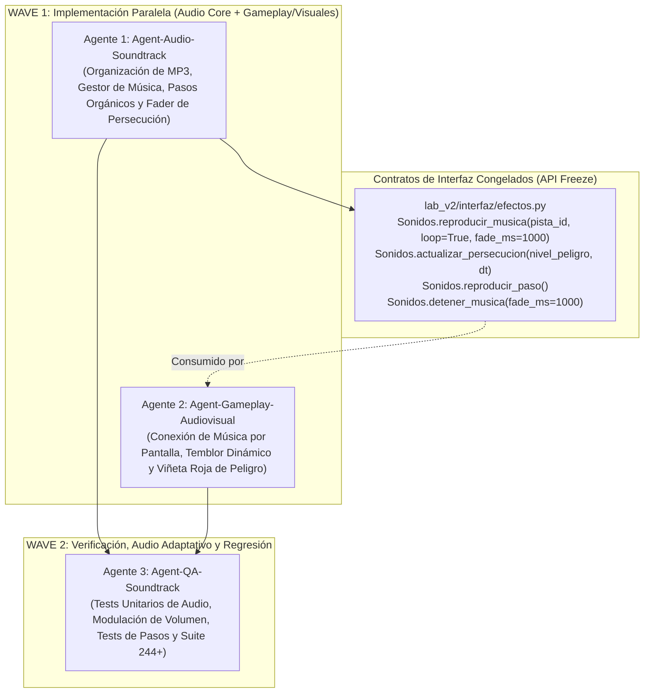

# Plan de Orquestación Multi-Agente: Banda Sonora Completa, Pasos Orgánicos, Audio Dinámico de Persecución y Peligro Crítico Audiovisual

**Proyecto:** *Laberinto: El Umbral de Ceniza* (`lab_v2`)  
**Módulos Afectados:** Motor de Audio y Efectos (`interfaz/efectos.py`), Interfaz y Pantallas del Juego (`interfaz/pantallas.py`), Recursos de Audio (`lab_v2/sonidos/`), y Banco de Pruebas (`pruebas/test_audio_soundtrack.py`).  
**Documento de Referencia:** Auditoría de Experiencia y Jugabilidad.

---

## 1. Objetivos Fundamentales del Plan

1. **Integración Integral de la Banda Sonora (Soundtrack Completo):**
   - Incorporar y organizar las pistas musicales generadas en el repositorio:
     * `musica_menu.mp3`: Pantalla de inicio, selección de niveles y créditos.
     * `musica_campamento.mp3`: Claro de Ceniza (hoguera, interacción con NPCs, descanso e inventario).
     * `musica_laberinto.mp3`: Exploración subterránea en los niveles (dark ambient, sutil y envolvente).
     * `musica_persecucion.mp3` (o `musica_persecusion.mp3`): Pánico y huida contrarreloj.
     * `musica_victoria.mp3`: Triunfo amargo y solemne al cruzar el Umbral con estrellas y cofres.
     * `musica_derrota.mp3`: Game Over y muerte en la niebla.
   - Organizar las pistas en `lab_v2/sonidos/musica/` manteniendo tolerancia de búsqueda en la raíz para evitar errores de ruta.

2. **Efecto de Pasos Orgánicos Anti-Repetición (Footstep SFX):**
   - Reemplazar el pitido sintético retro por las 4 tomas de pisadas reales (`paso1.mp3`, `paso2.mp3`, `paso3.mp3`, `paso4.mp3`).
   - Implementar un algoritmo pseudo-aleatorio que evite la repetición inmediata del mismo sonido (*anti-machine gun effect*) al caminar tanto en el Campamento como en el Laberinto.

3. **Música Adaptativa de Persecución con Atenuación Suave de Alejamiento (Fade-Out Continuo):**
   - *Requisito Crítico:* La música de persecución **NO debe cortarse de golpe** al escapar de la Sombra o el enemigo.
   - Se reproduce en un canal de audio independiente sobre la música del laberinto.
   - Su volumen se modula mediante interpolación continua (*lerp*) según la distancia del jugador al peligro (`self.peligro`).
   - Al alejarse de la sombra, el volumen desciende de forma suave y cinematográfica hasta apagarse sin sobresaltos, permitiendo que la persecución se active y desactive múltiples veces por partida con total naturalidad.

4. **Efecto de Peligro Crítico en Pantalla (Visual y Temblor):**
   - Cuando la Sombra o un enemigo en persecución BFS esté en rango crítico (`distancia <= 3` o `peligro > 0.45`):
     * **Viñeta roja pulsante:** El borde de la pantalla se tiñe de carmesí con un pulso rítmico que simula un latido cardíaco acelerado.
     * **Temblor de pantalla dinámico (`self.shake`):** La pantalla tiembla con intensidad directamente proporcional a la cercanía de la amenaza.

---

## 2. Topología de Agentes y Matriz de Propiedad Estricta (Zero-Conflict)

Los archivos modificables están estrictamente particionados para garantizar desarrollo paralelo con cero conflictos de merge:

$$\text{Archivos}(\text{Agent-Audio-Soundtrack}) \cap \text{Archivos}(\text{Agent-Gameplay-Audiovisual}) \cap \text{Archivos}(\text{Agent-QA-Soundtrack}) = \emptyset$$



### Tabla de Propiedad Exclusiva de Archivos

| Agente | Identificador | Rol Especializado | Modelo Recomendado | Archivos de Escritura Exclusiva | Archivos de Solo Lectura |
| :--- | :--- | :--- | :--- | :--- | :--- |
| **Agente 1** | `Agent-Audio-Soundtrack` | Arquitecto de Audio y Música Adaptativa. | `Claude Sonnet 5.5 (Medium)` | • `lab_v2/interfaz/efectos.py`<br>• `lab_v2/sonidos/` *(organización de carpetas y archivos)* | • `lab_v2/interfaz/pantallas.py`<br>• `lab_v2/interfaz/app.py` |
| **Agente 2** | `Agent-Gameplay-Audiovisual` | Ingeniero de Pantallas, Efectos de Peligro y Jugabilidad. | `Claude Sonnet 5.5 (Medium)` / `Gemini 4 Argon` | • `lab_v2/interfaz/pantallas.py` | • `lab_v2/interfaz/efectos.py`<br>• `lab_v2/sonidos/*` |
| **Agente 3** | `Agent-QA-Soundtrack` | Especialista en Pruebas de Integración y Regresión. | `Claude Sonnet 5.5 (Medium)` | • `lab_v2/pruebas/test_audio_soundtrack.py` *(nuevo)* | • Todos los módulos de `lab_v2/*` |

---

## 3. Contratos de Interfaz Compartidos (API Freeze)

### 3.1. Extensión de `Sonidos` (`lab_v2/interfaz/efectos.py`)

```python
class Sonidos:
    # Mapeo de pistas de música tolerante a nombres y rutas
    PISTAS_MUSICA = {
        "menu": ["lab_v2/sonidos/musica/musica_menu.mp3", "musica_menu.mp3"],
        "campamento": ["lab_v2/sonidos/musica/musica_campamento.mp3", "musica_campamento.mp3"],
        "laberinto": ["lab_v2/sonidos/musica/musica_laberinto.mp3", "musica_laberinto.mp3"],
        "persecucion": ["lab_v2/sonidos/musica/musica_persecucion.mp3", "musica_persecusion.mp3", "musica_persecucion.mp3"],
        "victoria": ["lab_v2/sonidos/musica/musica_victoria.mp3", "musica_victoria.mp3"],
        "derrota": ["lab_v2/sonidos/musica/musica_derrota.mp3", "musica_derrota.mp3"],
    }

    def reproducir_musica(self, pista_id: str, bucle: bool = True, fade_ms: int = 1200) -> bool:
        """Reproduce la pista musical principal con fundido suave (fade-in)."""
        ...

    def detener_musica(self, fade_ms: int = 1000) -> None:
        """Desvanece la música principal suavemente."""
        ...

    def actualizar_persecucion(self, nivel_peligro: float, dt: float) -> None:
        """
        Modula el volumen del canal de persecución según el nivel_peligro (0.0 a 1.0).
        
        REQUISITO DE ATENUACIÓN SUAVE (EFECTO DE ALEJAMIENTO):
        - Interpolación continua: volumen_actual += (volumen_objetivo - volumen_actual) * dt * 2.5
        - Si nivel_peligro <= 0.05, el volumen decae hasta 0.0 y se pausa/detiene sin cortes bruscos.
        - Si nivel_peligro > 0.15, se reproduce/reanuda en bucle suave en su canal dedicado.
        """
        ...

    def reproducir_paso(self) -> None:
        """
        Reproduce una pisada eligiendo pseudo-aleatoriamente entre paso1..paso4,
        garantizando que nunca se repita la misma pisada dos veces seguidas.
        """
        ...
```

---

## 4. Plan de Ejecución por Oleadas (Waves)

```text
├── WAVE 1 (Paralelo):
│   ├── [T-01] [Agent-Audio-Soundtrack] Gestor de Bandas Sonoras, Pasos Orgánicos y Fader de Persecución (efectos.py)
│   └── [T-02] [Agent-Gameplay-Audiovisual] Integración de Audio en Pantallas, Temblor y Viñeta Crítica (pantallas.py)
└── WAVE 2 (Verificación):
    └── [T-03] [Agent-QA-Soundtrack] Banco de Pruebas de Audio Adaptativo, No-Repetición y Regresión (test_audio_soundtrack.py)
```

---

### WAVE 1: Implementación Paralela (Audio Core + Gameplay/Visuales)

#### `[T-01]` Gestor de Bandas Sonoras, Pasos Orgánicos y Fader de Persecución
* **Agente Asignado:** `Agent-Audio-Soundtrack`
* **Modelo Recomendado:** `Claude Sonnet 5.5 (Medium)`
* **Archivos de Escritura Exclusiva:** `lab_v2/interfaz/efectos.py`, `lab_v2/sonidos/`
* **Instrucciones Técnicas:**
  1. **Organización de Recursos:**
     - Crear los directorios `lab_v2/sonidos/musica/` y `lab_v2/sonidos/sfx/`.
     - Mover o copiar las pistas musicales correspondientes: `musica_menu.mp3`, `musica_campamento.mp3`, `musica_laberinto.mp3`, `musica_persecucion.mp3` (copiando también `musica_persecusion.mp3`), `musica_victoria.mp3`, `musica_derrota.mp3`.
     - Mover o copiar los pasos: `paso1.mp3`, `paso2.mp3`, `paso3.mp3`, `paso4.mp3`.
  2. **Pasos Orgánicos en `Sonidos`:**
     - Cargar los 4 sonidos de pasos en `self.sonidos_pasos = []`.
     - Implementar `reproducir_paso()` con lógica anti-repetición (`self._ultimo_paso`).
     - Reemplazar la llamada a `"paso"` en `reproducir("paso")` para delegar en `reproducir_paso()`.
  3. **Sistema de Música y Fader Dinámico de Persecución:**
     - Implementar `reproducir_musica(pista_id, bucle=True, fade_ms=1200)` usando `pygame.mixer.music`.
     - Reservar un canal de audio dedicado para la persecución (`self.canal_persecucion = pygame.mixer.Channel(6)`).
     - Cargar `musica_persecucion.mp3` como `pygame.mixer.Sound` para ese canal.
     - Implementar `actualizar_persecucion(nivel_peligro, dt)`:
       * Calcular el `volumen_objetivo = min(1.0, max(0.0, (nivel_peligro - 0.15) / 0.85))`.
       * Interpolar suavemente el volumen actual hacia el objetivo con una constante de tiempo proporcional a `dt * 2.2`.
       * Si el volumen desciende de 0.01, silenciar completamente el canal sin detener bruscamente la posición para reanudar limpio si la sombra vuelve a acercarse.

#### `[T-02]` Integración de Audio en Pantallas, Temblor y Viñeta Crítica
* **Agente Asignado:** `Agent-Gameplay-Audiovisual`
* **Modelo Recomendado:** `Claude Sonnet 5.5 (Medium)` / `Gemini 4 Argon`
* **Archivos de Escritura Exclusiva:** `lab_v2/interfaz/pantallas.py`
* **Instrucciones Técnicas:**
  1. **Vinculación de Música por Pantalla:**
     - En `Menu.__init__` y `Niveles`: activar `self.app.sonidos.reproducir_musica("menu")`.
     - En `Campamento.__init__`: activar `self.app.sonidos.reproducir_musica("campamento")`.
     - En `Juego.__init__`: activar `self.app.sonidos.reproducir_musica("laberinto")`.
     - Al ganar la partida (`self.partida.estado == GANO`): reproducir `musica_victoria`.
     - Al perder la partida (`self.partida.estado in (SIN_MOVIMIENTOS, ATRAPADO)`): reproducir `musica_derrota`.
  2. **Efecto de Alejamiento y Audio Dinámico de Persecución:**
     - En `Juego.actualizar(dt)`:
       * Llamar en cada cuadro a `self.app.sonidos.actualizar_persecucion(self.peligro, dt)`.
  3. **Peligro Crítico Audiovisual (Temblor y Viñeta):**
     - En `Juego.actualizar(dt)`:
       * Si `self.peligro > 0.45` o `cerca_persecucion <= 3`:
         * Inyectar temblor de pantalla continuo:
           `temblor_peligro = (self.peligro - 0.4) * 5.5 * (0.6 + 0.4 * math.sin(self.t * 18))`
           `self.shake = max(self.shake, temblor_peligro)`
     - En `Juego.dibujar(surf)`:
       * Reforzar la viñeta roja pulsante cuando `self.peligro > 0.10`, añadiendo un borde de viñeta carmesí profundo más marcado cuando el peligro supera 0.60.

---

### WAVE 2: Verificación, Audio Adaptativo y Regresión

#### `[T-03]` Banco de Pruebas de Audio Adaptativo, No-Repetición y Regresión
* **Agente Asignado:** `Agent-QA-Soundtrack`
* **Modelo Recomendado:** `Claude Sonnet 5.5 (Medium)`
* **Archivos de Escritura Exclusiva:** `lab_v2/pruebas/test_audio_soundtrack.py`
* **Instrucciones Técnicas:**
  1. Crear `lab_v2/pruebas/test_audio_soundtrack.py`:
     - `test_carga_pistas_musica`: Validar que todas las pistas (`menu`, `campamento`, `laberinto`, `persecucion`, `victoria`, `derrota`) se localizan correctamente.
     - `test_antirepeticion_pasos`: Simular 50 pasos consecutivos y verificar que nunca hay dos pasos con el mismo índice seguidos (`paso_i != paso_{i+1}`).
     - `test_fader_persecucion_atenuacion_suave`: Verificar que ante una caída brusca de peligro de 1.0 a 0.0, el volumen no cae a 0 instantáneamente sino que desciende gradualmente por *lerp*.
     - `test_musica_pantallas_transicion`: Validar que las pantallas solicitan la pista musical correcta.
  2. Ejecutar la suite completa (`$env:PYTHONPATH="lab_v2"; python -m unittest discover -s lab_v2/pruebas`) asegurando que los 244 tests previos más los nuevos pasen con 0 errores y 0 fallos.

---

## 5. Asignación de Agentes, Modelos y Prompts de Ejecución

### Resumen de Recursos Necesarios
* **Total de Agentes:** 3 agentes en 2 oleadas (Wave 1: 2 agentes paralelos; Wave 2: 1 agente de control de calidad).
* **Modelos Aptos:**
  - `Claude Sonnet 5.5 (Medium)` para la lógica de canales de audio, modulación de volumen, anti-repetición y tests.
  - `Claude Sonnet 5.5 (Medium)` o `Gemini 4 Argon` para pantallas de juego, viñetas y temblor de cámara.

---

### 📋 PROMPT LISTO PARA AGENTE 1 (`Agent-Audio-Soundtrack`)
```text
Rol: Agent-Audio-Soundtrack (Arquitecto de Audio y Música Adaptativa)
Modelo Recomendado: Claude Sonnet 5.5 (Medium)
Archivos de Escritura Exclusiva:
- lab_v2/interfaz/efectos.py
- lab_v2/sonidos/ (organizar carpetas y recursos)
Archivos de Solo Lectura:
- lab_v2/interfaz/pantallas.py
- lab_v2/interfaz/app.py

Tu misión es implementar el gestor de música de fondo, pasos orgánicos y fader de persecución en lab_v2:
1. En la raíz existen: musica_menu.mp3, musica_campamento.mp3, musica_laberinto.mp3, musica_persecusion.mp3, musica_victoria.mp3, musica_derrota.mp3, y paso1.mp3..paso4.mp3.
   Crea lab_v2/sonidos/musica/ y lab_v2/sonidos/sfx/ y copia/organiza estos archivos (asegura compatibilidad para encontrar musica_persecucion o musica_persecusion indistintamente).
2. En lab_v2/interfaz/efectos.py extiende la clase Sonidos:
   - Carga los 4 pasos en self.sonidos_pasos. Implementa reproducir_paso(): debe seleccionar aleatoriamente entre los 4 sin repetir nunca el mismo paso dos veces seguidas. Haz que self.reproducir("paso") invoque este método.
   - Implementa reproducir_musica(pista_id, bucle=True, fade_ms=1200) y detener_musica(fade_ms=1000) usando pygame.mixer.music de forma robusta y con manejo de excepciones (modo sin audio).
   - Implementa el audio de persecución adaptativo:
     * Reserva un canal para persecución (ej. self.canal_persecucion = pygame.mixer.Channel(6)).
     * Carga la pista de persecución como Sound.
     * Implementa actualizar_persecucion(nivel_peligro, dt): modula el volumen del canal usando interpolación continua (lerp) hacia el objetivo. Al alejarse de la sombra/enemigo (peligro cayendo), el volumen debe desvanecerse suavemente hasta 0 sin cortes bruscos.
3. Respeta tu titularidad de archivos exclusiva y notifica el freeze de la API al terminar.
```

---

### 📋 PROMPT LISTO PARA AGENTE 2 (`Agent-Gameplay-Audiovisual`)
```text
Rol: Agent-Gameplay-Audiovisual (Ingeniero de Pantallas, Efectos de Peligro y Jugabilidad)
Modelo Recomendado: Claude Sonnet 5.5 (Medium) / Gemini 4 Argon
Archivos de Escritura Exclusiva:
- lab_v2/interfaz/pantallas.py
Archivos de Solo Lectura:
- lab_v2/interfaz/efectos.py
- lab_v2/sonidos/*

Tu misión es conectar la música en cada pantalla del juego e implementar el temblor y viñeta roja de peligro crítico:
1. Conexión de Música por Pantalla:
   - En Menu y Niveles: llamar a self.app.sonidos.reproducir_musica("menu") si no está sonando ya.
   - En Campamento: reproducir_musica("campamento").
   - En Juego: reproducir_musica("laberinto").
   - Al finalizar partida: reproducir_musica("victoria") si ganó, o reproducir_musica("derrota") si perdió/atrapado.
2. Audio Dinámico de Persecución (Efecto de Alejamiento):
   - En Juego.actualizar(dt): invocar self.app.sonidos.actualizar_persecucion(self.peligro, dt) en cada cuadro para que el volumen responda a la distancia con la sombra/enemigo.
3. Peligro Crítico en Pantalla (Temblor y Viñeta Roja):
   - Cuando self.peligro > 0.45 o cerca_persecucion <= 3:
     * Inyectar temblor continuo en self.shake: self.shake = max(self.shake, (self.peligro - 0.4) * 6.0 * (0.6 + 0.4 * math.sin(self.t * 18))).
   - En Juego.dibujar(surf): asegurar que la viñeta roja pulse intensamente al ritmo de tensión cuando el peligro sea elevado.
4. Pasos en movimiento:
   - Asegúrate de que las pisadas tanto en Campamento como en Juego usen self.app.sonidos.reproducir("paso") (que ahora dispara pasos orgánicos anti-repetición).
5. Respeta tu titularidad de archivos exclusiva (solo lab_v2/interfaz/pantallas.py).
```

---

### 📋 PROMPT LISTO PARA AGENTE 3 (`Agent-QA-Soundtrack`)
```text
Rol: Agent-QA-Soundtrack (Especialista en Pruebas de Integración y Regresión)
Modelo Recomendado: Claude Sonnet 5.5 (Medium)
Archivos de Escritura Exclusiva:
- lab_v2/pruebas/test_audio_soundtrack.py
Archivos de Solo Lectura:
- Todos los módulos de lab_v2/*

Tu misión es validar formalmente la banda sonora, los pasos orgánicos y el peligro crítico:
1. Crea lab_v2/pruebas/test_audio_soundtrack.py con pruebas unitarias y de integración:
   - test_localizacion_archivos_audio: Verifica que las 6 pistas musicales y los 4 pasos existen y son detectados.
   - test_antirepeticion_pasos: Simula 40 llamadas seguidas a reproducir_paso() y valida que dos pasos idénticos nunca se ejecuten consecutivamente.
   - test_fader_persecucion_atenuacion_suave: Valida que actualizar_persecucion modula el volumen por interpolación y que ante peligro=0.0 el volumen se reduce suavemente sin cortes.
   - test_invocacion_musica_pantallas: Valida que las pantallas solicitan las pistas correctas (menu, campamento, laberinto, victoria, derrota).
2. Ejecuta la suite de pruebas completa:
   $env:PYTHONPATH="lab_v2"; python -m unittest discover -s lab_v2/pruebas
   Verifica que los 244 tests previos más los nuevos pasen con 0 errores y 0 fallos.
```
